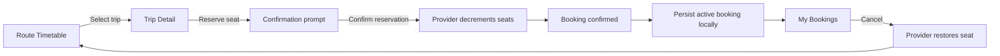

# CampusShuttle app flow

The interface displays the four journey cues on the relevant screens: Timetable, Trip details, Reserve seat, and Confirmation. The timetable and booking collections use `ListView`; trip and booking content use Material 3 `Card` and `Icon` widgets.

## State ownership

`ShuttleStore` extends `ChangeNotifier` and owns the trip list and active bookings. Widgets read it through Provider. A successful reservation updates the selected trip and booking list before calling `notifyListeners()`, so Route Timetable, Trip Detail, summary metrics, and My Bookings stay synchronized.

## Persistence

Bookings are encoded as JSON under `campus_shuttle_bookings_v1` in `shared_preferences`. On startup, the store accepts only known trip IDs, ignores malformed records, and prevents duplicate bookings for the same departure. Loading a valid booking decrements that trip’s displayed availability.

## Edge cases

- A trip cannot be booked twice on the same device.
- A trip with zero available seats disables reservation.
- Unknown, malformed, and duplicate stored bookings are ignored.
- Cancellation restores at most the trip’s initial available-seat count.
- Search with no match shows a clear empty state.

## Data boundary

Trip definitions are in app memory. Active bookings are stored locally. There is no remote database in this assessed prototype. A production multi-user implementation would require a server-side booking transaction so concurrent students cannot oversell capacity.
