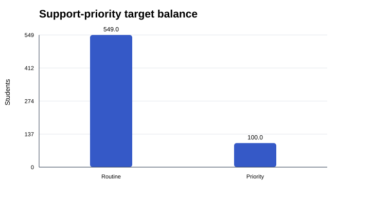
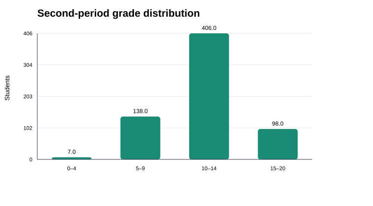
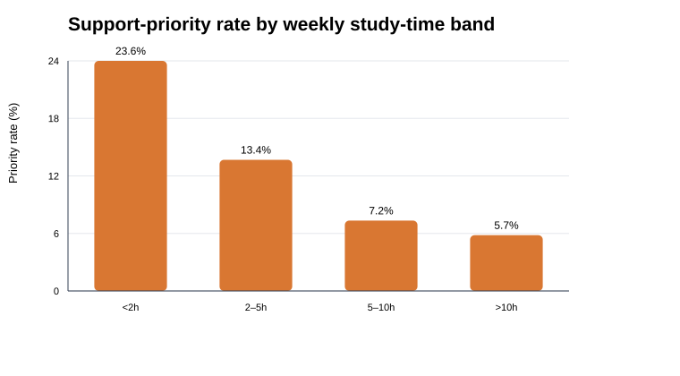
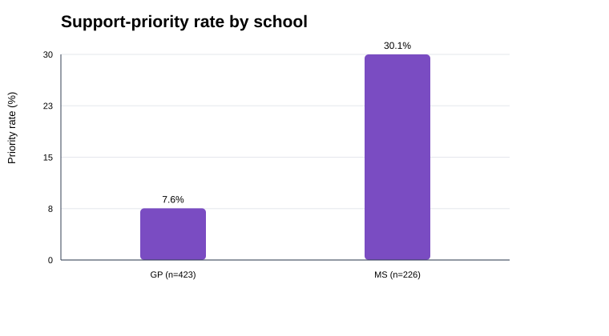
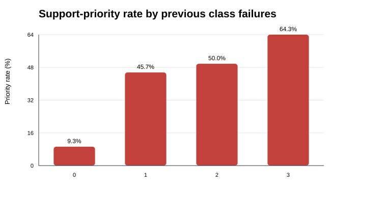

# Exploratory data analysis

Dataset: UCI Student Performance, Portuguese-language course (Cortez, 2008).
Rows: 649; source columns: 33; modelling features: 10.
Missing cells in modelling fields and target: 0; exact duplicate rows: 0.
Target counts: routine=549, priority=100 (15.4% priority).

## Numeric summary

| Statistic | G1 | G2 | G3 | studytime | failures | absences | traveltime |
| --- | ---: | ---: | ---: | ---: | ---: | ---: | ---: |
| count | 649.00 | 649.00 | 649.00 | 649.00 | 649.00 | 649.00 | 649.00 |
| mean | 11.40 | 11.57 | 11.91 | 1.93 | 0.22 | 3.66 | 1.57 |
| std | 2.75 | 2.91 | 3.23 | 0.83 | 0.59 | 4.64 | 0.75 |
| min | 0.00 | 0.00 | 0.00 | 1.00 | 0.00 | 0.00 | 1.00 |
| 25% | 10.00 | 10.00 | 10.00 | 1.00 | 0.00 | 0.00 | 1.00 |
| 50% | 11.00 | 11.00 | 12.00 | 2.00 | 0.00 | 2.00 | 1.00 |
| 75% | 13.00 | 13.00 | 14.00 | 2.00 | 0.00 | 6.00 | 2.00 |
| max | 19.00 | 19.00 | 19.00 | 4.00 | 3.00 | 32.00 | 4.00 |

## Data-quality issues

- 15 rows have G3 = 0 (8 of them with G2 > 0). These look like students who left or missed the final assessment rather than true zero attainment, so they are noisy positive labels. They are kept, because excluding them would hide real disengagement, and flagged as a limitation.
- Absences are right-skewed (skew 2.02); 8 rows exceed 20 and the maximum is 32. Standard scaling keeps them, and logistic regression is sensitive to such outliers.
- G1 and G2 are strongly collinear (r = 0.865) and G2 correlates 0.919 with G3, so coefficients for G1 and G2 should not be read independently.
- `studytime` and `traveltime` are ordinal bands (1–4), not hours. They are scaled as ordered numbers, which assumes equal spacing between bands.
- `student.txt` documents failures as `n if 1<=n<3, else 4`, but the maximum observed value is 3. Value 3 is therefore treated as '3 or more'.
- G1 and G2 are quoted strings in the raw CSV, but they parse cleanly as integers. No missing values or exact duplicates are present.

## Correlation with final grade G3

| Feature | r with G3 |
| --- | ---: |
| G1 | 0.826 |
| G2 | 0.919 |
| studytime | 0.250 |
| failures | -0.393 |
| absences | -0.091 |
| traveltime | -0.127 |

## Observations

- The positive class is the minority, so accuracy alone is unsuitable. Balanced accuracy, positive-class precision, recall, F1, ROC AUC, and a confusion matrix are reported.
- G1 and G2 are earlier-period grades. UCI documents their strong correlation with final grade G3; this makes the prototype a mid-year review tool, not an enrolment-time prediction.
- The source contains demographic, family, health, and alcohol-use fields. They are excluded from this model because they are unnecessary for the classroom objective and could create intrusive or discriminatory profiling.
- The supplied dataset has no documented missing values. The pipeline still includes training-fitted imputers so its preprocessing steps are explicit and robust to future missing inputs.
- Records come from two Portuguese secondary schools and cannot be assumed to represent another institution, country, age group, or current cohort.
- Priority rate differs sharply by school: GP 7.6% vs MS 30.1%. `school` is not a model input, but any input correlated with school can carry this gap, so errors must be checked per school (see the report's bias section).
- Priority rate rises with previous failures: 0 → 9.3%, 1 → 45.7%, 2 → 50.0%, 3 → 64.3%.

