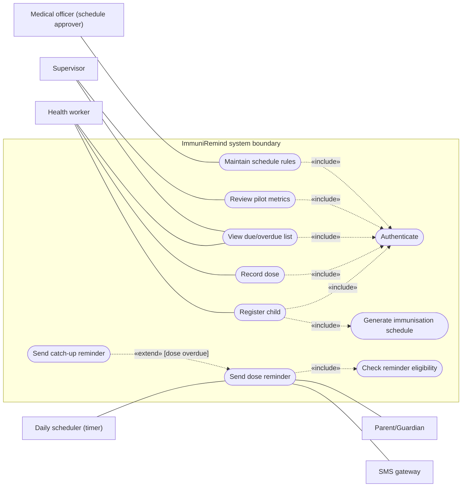
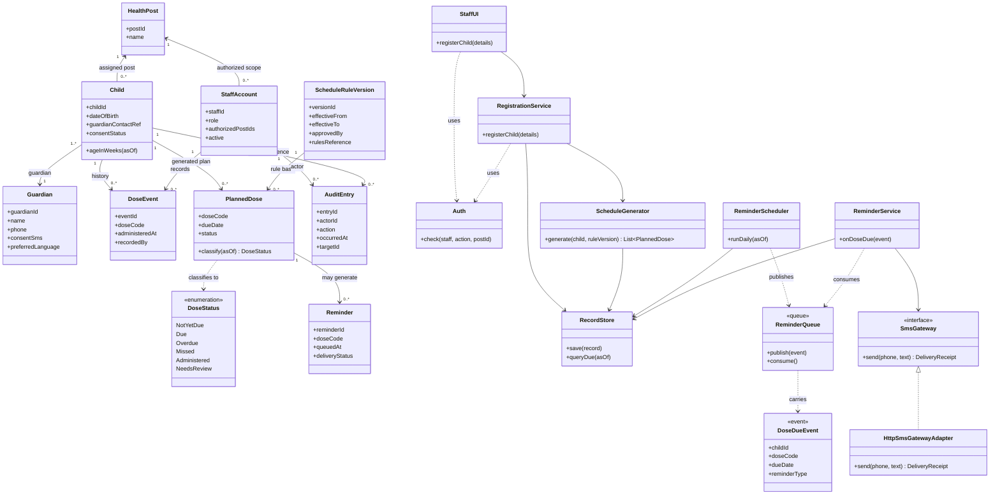
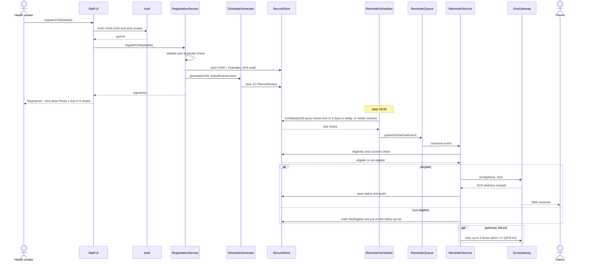
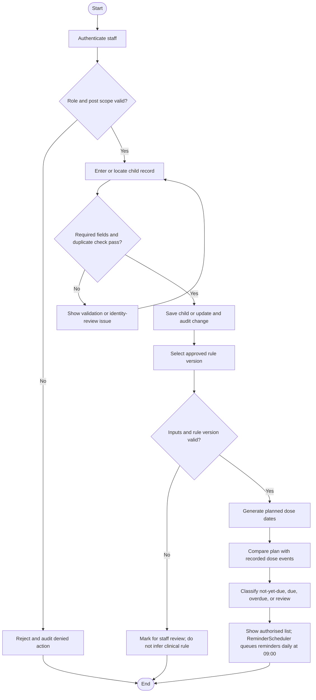
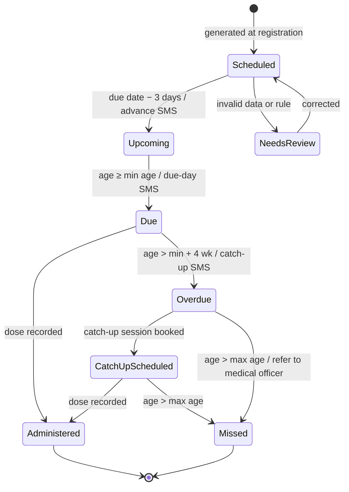
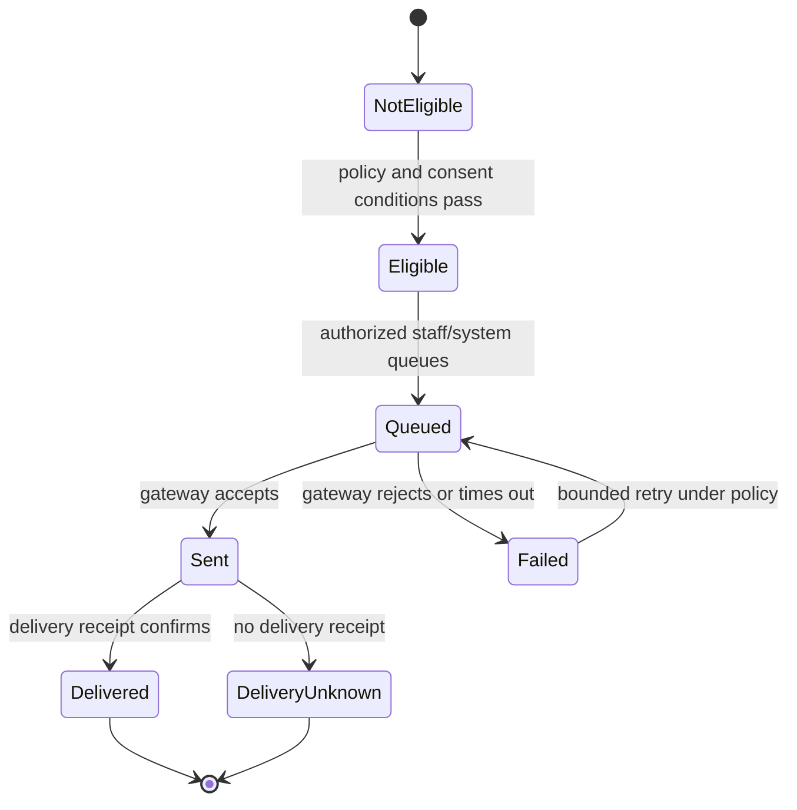
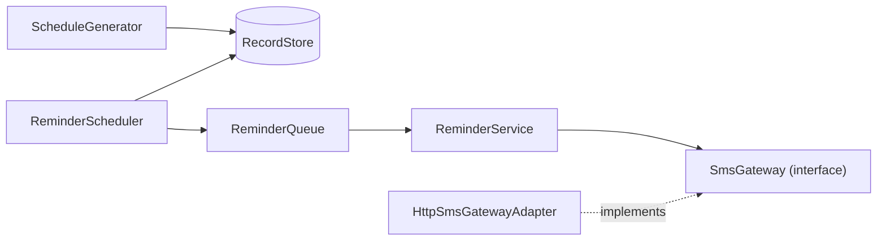

# Design Specification (UML Package) — ImmuniRemind

These models cover the requirements in [the SRS](01_SRS_and_Priorities.md). They are logical design views, not implementation claims. All Mermaid diagrams use the same terms: health worker, supervisor, schedule rule version, due/overdue status, reminder, and audit entry. The package holds a use-case diagram, a class diagram, a sequence diagram, an activity diagram and two state diagrams, and they are kept consistent with one another (see the checks stated under each diagram).

## 1. Use-case model

Actors sit outside the system boundary. The «include» and «extend» relationships are drawn as labelled dashed edges. The four staff actors use Authenticate through an «include» from each staff use case.

Send catch-up reminder extends Send dose reminder only when the dose has become Overdue; the base use case is complete without it. Send dose reminder reaches the Parent/Guardian through the SMS gateway, so both are linked to it.

## 2. Class model

Logical model notes: `PlannedDose` is derived from the child record and a particular approved rule version; it is not an administered dose. `DoseEvent` records observed administration. `ScheduleGenerator` has no link to `ReminderService` in either direction; the two meet only through `RecordStore` data and `DoseDueEvent`. The health worker in the sequence diagram is a `StaffAccount`, and the Parent is a `Guardian` (an external actor, not a system class). The actual minimal personal-data fields, retention, and identity-matching rules require authority approval.

## 3. Sequence model — register a child and send a dose reminder

Which requirements each step realises: the Auth check realises FR-01 (role and post scope) and NFR-03 (access control). Validation, the duplicate check and the save of Child and Guardian realise FR-02, and the audit write realises NFR-05 (auditability). Generating the 12 PlannedDoses under the active rule version realises FR-07 (using the approved versioned rules of FR-06), and the confirmation message on the UI supports NFR-08 (usability). The daily 09:00 query classifies doses (FR-08) and selects those needing the advance, due-day or catch-up SMS (FR-09). Publishing the DoseDueEvent and consuming it in ReminderService keeps scheduling apart from sending. The eligibility and consent check realises the consent condition of FR-09, and the SMS text limits of NFR-04 (data protection) apply to the send step. Recording the delivery receipt and status realises FR-10 and NFR-02 (delivery), and the retry within 2 hours after a gateway failure realises NFR-01 (dispatch reliability). The not-eligible branch puts the record on the follow-up list, so no message is sent without consent.

## 4. Activity model — registration through due status

## 5. State model — the immunisation schedule (PlannedDose)

Each PlannedDose moves through the states below. Administered, Overdue, Missed and NeedsReview are `DoseStatus` values; Scheduled, Upcoming and CatchUpScheduled are lifecycle states that refine NotYetDue and Overdue. Due is the `DoseStatus.Due` value.

The states follow the status rule: a dose is Due from its minimum age to minimum age plus 4 weeks, Overdue after that while catch-up is still allowed, and Missed once the child passes the maximum age (referred to the medical officer).

### Reminder lifecycle (per SMS)

The two diagrams are separate on purpose. A reminder can fail while a dose is still due; a gateway acceptance does not prove delivery. “Due” and “overdue” boundaries must follow the authority-approved date and timezone policy.

## 6. Cohesion and coupling rationale

| Component | Cohesion rationale | Coupling constraint |
|---|---|---|
| Registration | Owns validation and controlled changes to child/contact records | Exposes child-record operations; does not calculate clinical due dates |
| Schedule service | Owns version selection, due-date calculation, and status classification | Reads approved rules and dose history through defined interfaces; must not embed unapproved clinical intervals |
| Dose history | Owns append/correction workflow and audit trail for administration events | Depends on identity and authorization checks; does not decide reminder delivery |
| Reminder service | Owns eligibility, queueing, idempotency, attempts, and outcome recording | Uses an SMS gateway adapter; core workflow should not depend on a particular provider API |
| Supervisor reporting | Owns filtered due/overdue views and metric definitions | Reads authorized, minimized data through service interfaces; does not bypass post scope |
| Identity/authorization | Owns role and post-scope decisions | Called by every protected operation; policy is not duplicated in individual screens |

Each component has one primary reason to change. Interfaces are kept narrow so a gateway change does not alter schedule calculation, and screen code cannot bypass record-scope checks.

## 7. How schedule generation and SMS reminders stay loosely coupled

Schedule generation and SMS reminders are two separate halves of the design. `ScheduleGenerator` writes PlannedDose rows into `RecordStore`. `ReminderScheduler` reads those rows each day, publishes a `DoseDueEvent` to `ReminderQueue`, and `ReminderService` consumes the event and sends through the `SmsGateway` interface. The two halves share only data (the PlannedDose rows) and one event type (`DoseDueEvent`). There are no direct calls in either direction.

Consequences of this design:

1. An SMS outage never blocks registration or schedule generation, because registration ends once the PlannedDoses are saved.
2. The gateway provider can change by swapping the adapter only; `ReminderService` depends on the `SmsGateway` interface, not on a provider API.
3. Retries and idempotency live entirely in `ReminderService` (NFR-01), so the scheduler can publish an event again without sending a second SMS.
4. Each side can be tested alone, with a fake queue or a fake gateway.

## 8. Test design

Test design (equivalence classes, BVA by age in weeks, decision table) is in `05_Test_Plan_and_Evidence.md`.

## 9. Requirements traceability (summary)

| Requirement group | Design coverage |
|---|---|
| FR-01, FR-03, FR-04, FR-11; NFR-03, NFR-05 | Use-case Authenticate «include» relationships, sequence Auth check and audit steps, audit-oriented class model (StaffAccount, AuditEntry, Auth) |
| FR-02, FR-05, FR-06, FR-07, FR-08 | Child/Guardian/DoseEvent/ScheduleRuleVersion/PlannedDose model, ScheduleGenerator, activity diagram, schedule state diagram |
| FR-09, FR-10; NFR-01, NFR-02, NFR-04 | Reminder classes (ReminderScheduler, ReminderQueue, ReminderService, SmsGateway), reminder sequence with retry, reminder lifecycle, loose-coupling section |
| FR-12; NFR-06, NFR-07, NFR-08 | Schedule/quality acceptance and pilot measures in the project controls and quality files; usability confirmation step in the sequence |
