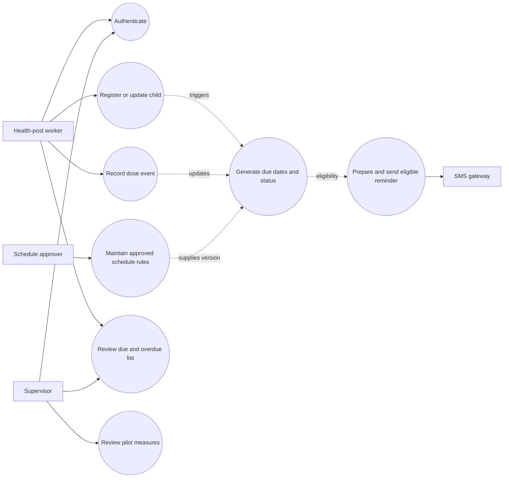
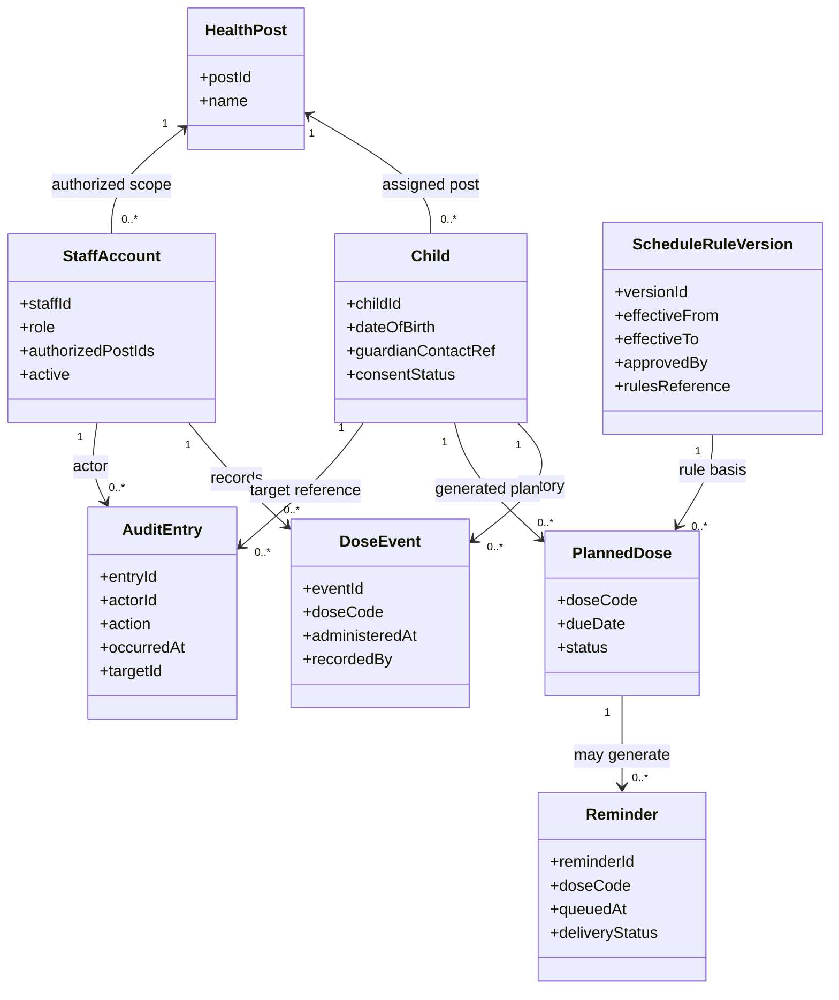
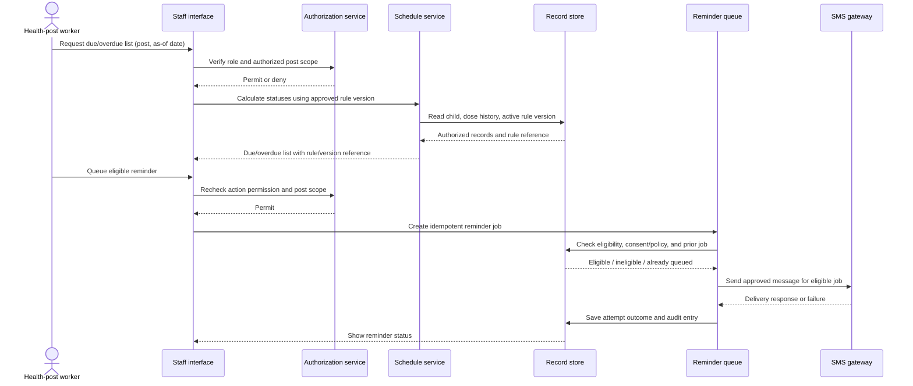
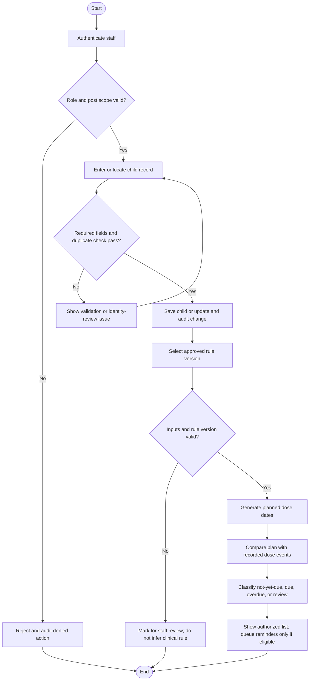
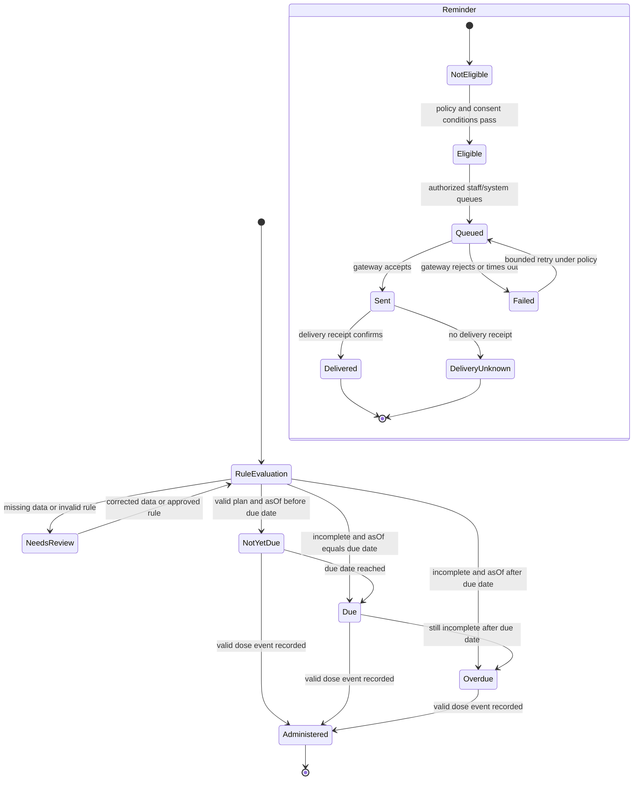

# Design and Test Specification — ImmuniRemind

These models cover the requirements in [the SRS](01_SRS_and_Priorities.md). They are logical design views, not implementation claims. All Mermaid diagrams use the same terms: health-post worker, supervisor, schedule rule version, due/overdue status, reminder, and audit entry.

## 1. Use-case model

## 2. Class model

Logical model notes: `PlannedDose` is derived from the child record and a particular approved rule version; it is not an administered dose. `DoseEvent` records observed administration. The actual minimal personal-data fields, retention, and identity-matching rules require authority approval.

## 3. Sequence model — due dose reminder

The sequence includes authorization before record access and again before the reminder action. Retries use an idempotency key so a retry does not create a second logical reminder. Gateway delivery is external and can fail; a queued attempt is not equivalent to confirmed delivery.

## 4. Activity model — registration through due status

## 5. State model — planned dose and reminder lifecycle

The diagram separates dose status from reminder delivery. A reminder can fail while a dose is still due; a gateway acceptance does not prove delivery. “Due” and “overdue” boundaries must follow the authority-approved date and timezone policy.

## 6. Cohesion and coupling rationale

| Component | Cohesion rationale | Coupling constraint |
|---|---|---|
| Registration | Owns validation and controlled changes to child/contact records | Exposes child-record operations; does not calculate clinical due dates |
| Schedule service | Owns version selection, due-date calculation, and status classification | Reads approved rules and dose history through defined interfaces; must not embed unapproved clinical intervals |
| Dose history | Owns append/correction workflow and audit trail for administration events | Depends on identity and authorization checks; does not decide reminder delivery |
| Reminder service | Owns eligibility, queueing, idempotency, attempts, and outcome recording | Uses an SMS gateway adapter; core workflow should not depend on a particular provider API |
| Supervisor reporting | Owns filtered due/overdue views and metric definitions | Reads authorized, minimized data through service interfaces; does not bypass post scope |
| Identity/authorization | Owns role and post-scope decisions | Called by every protected operation; policy is not duplicated in individual screens |

Each component has one primary reason to change. Interfaces are kept narrow so a gateway change does not alter schedule calculation, and screen code cannot bypass record-scope checks.

## 7. Equivalence classes and boundary-value test design

All tests use synthetic records and an authority-approved rule fixture. These are test cases to execute after implementation; no executions are claimed here.

| Input / function | Equivalence classes | Boundary values / expected handling |
|---|---|---|
| Date of birth (FR-02, FR-07) | Valid date; missing; malformed; future date; implausible date requiring review | Minimum supported date and current date; day before/at/after current date. Future DOB rejected or held for correction; exact historical lower bound is a policy decision. |
| Guardian contact (FR-02, FR-09) | Valid configured phone format; missing; malformed; duplicate/ambiguous contact | Minimum/maximum accepted normalized length under selected numbering policy; one below/at/one above; no send for invalid or ineligible contact. Format must be chosen by deployment authority. |
| Dose administration event (FR-05) | Valid expected dose; unknown dose code; duplicate event; date before birth; event after as-of date | Event date immediately before/on/after rule-allowed date; invalid dates require review; duplicate retry yields one event. Valid interval comes from approved rules. |
| Due status calculation (FR-07/08) | Complete history; incomplete history; missing data; unknown rule version | as-of date one day before due → not-yet-due; exactly due date → due; one day after → overdue, subject to agreed local-day/timezone semantics. |
| Rule version (FR-06/07) | Approved active; approved historical; not-yet-effective; expired; unapproved; overlapping | Effective date day before/on/day after activation and end; no overlapping or unapproved rule silently selected; ambiguous cases require review. |
| Authorization (FR-01/03/04/11) | Worker assigned to post; worker from another post; supervisor authorized scope; disabled/unauthenticated account | Exact post-scope boundary: permitted post succeeds; one unrelated post is denied; inactive and no-session cases are denied. |
| Reminder eligibility (FR-09/10) | Valid contact and consent/policy; no consent/unknown; duplicate queued job; gateway success/failure/timeout | Eligibility window immediately before/on/after configured threshold; duplicate submission/retry produces one logical job; no send if eligibility cannot be established. |
| Report filter (FR-11/12) | No filter; valid date range; empty range; invalid range; unauthorized post | Start/end boundaries inclusive as specified; same-day range; end before start is rejected; totals equal matching visible rows. |

## 8. Due/catch-up decision table

This table is a control-flow specification, not a clinical catch-up schedule. The authority supplies interval and catch-up policy; when the policy cannot determine the next action, the record goes to staff review.

| Rule inputs / condition | Rule set valid and approved? | Child inputs/history complete? | Dose already recorded? | Due date compared with as-of | Expected system result |
|---|---:|---:|---:|---|---|
| Any case | No | Any | Any | Any | **Needs review**; no due date and no reminder generated |
| Any case | Yes | No | Any | Any | **Needs review**; identify missing/conflicting input, do not infer a dose date |
| Dose under consideration | Yes | Yes | Yes | Any | **Administered/complete**; exclude from due list; preserve history |
| Planned dose | Yes | Yes | No | Due date later than as-of | **Not yet due**; may only be reminded if approved policy says so |
| Planned dose | Yes | Yes | No | Due date equals as-of | **Due**; eligible for reminder only if contact, consent, and policy checks pass |
| Planned dose | Yes | Yes | No | Due date earlier than as-of; no catch-up exception needed | **Overdue**; list for follow-up; reminder only under policy |
| Planned dose | Yes | Yes | No | Due date earlier than as-of; catch-up rule selects a valid next step | Apply approved catch-up outcome, recalculate under its version, and record rule reference |
| Planned dose | Yes | Yes | No | Due date earlier than as-of; catch-up rule is missing, conflicting, or ambiguous | **Needs review**; do not select a clinical action or send an unsupported message |

## 9. Requirements traceability (summary)

| Requirement group | Design/test coverage |
|---|---|
| FR-01, FR-03, FR-04, FR-11; NFR-03, NFR-05 | Use-case authorization boundary, sequence authorization steps, authorization equivalence classes, audit-oriented class model |
| FR-02, FR-05, FR-06, FR-07, FR-08 | Child/DoseEvent/RuleVersion/PlannedDose model, activity and state diagrams, date/rule BVA, decision table |
| FR-09, FR-10 | Reminder class, gateway sequence, reminder lifecycle, eligibility/retry BVA |
| FR-12; NFR-01, NFR-02, NFR-06, NFR-07, NFR-08 | Schedule/quality acceptance and pilot measures in the project controls and quality files |
