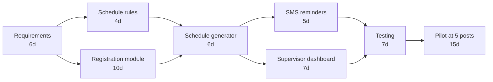
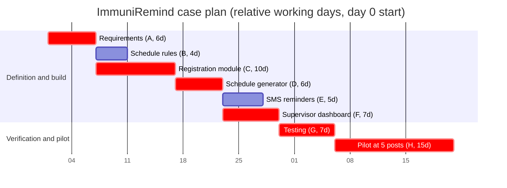

# Schedule and Project Controls — ImmuniRemind

## 1. Planning basis and dose volume

The case supplies these fixed planning inputs: 36,000 children under age five and approximately 12 scheduled doses per child. The planning volume is therefore:

**36,000 children × approximately 12 doses/child ≈ 432,000 dose records.**

This is a planning estimate, not a guarantee of database row count. New registrations, duplicate resolution, historical events, schedule changes, and retention can change the actual number.

The case gives task durations and dependencies below. Durations are treated as working days for the exercise. No calendar start date, holidays, staffing availability, procurement lead time, or resource capacity is supplied, so the 51-day result is an elapsed working-day plan under those assumptions, not a committed calendar delivery date.

## 2. Work breakdown and dependency network

| ID | Work package | Duration (days) | Immediate predecessor(s) | Scope/result |
|---|---|---:|---|---|
| A | Requirements | 6 | — | Requirements baseline and approval inputs |
| B | Schedule rules | 4 | A | Authority-reviewed schedule rules |
| C | Registration module | 10 | A | Child registration capability |
| D | Schedule generator | 6 | B, C | Due-date generation using approved rules and registered records |
| E | SMS reminders | 5 | D | Reminder workflow and gateway integration/test |
| F | Supervisor dashboard | 7 | D | Due/overdue supervisor view |
| G | Testing | 7 | E, F | Integrated verification and defect correction |
| H | Pilot at 5 health posts | 15 | G | Controlled five-post pilot and evaluation |

## 3. CPM forward/backward pass

Convention: day 0 is project start; early/late finish equals start plus duration. Float = LS − ES = LF − EF. The backward pass starts at day 51, the earliest finish of the final task.

| ID | Dur. | Pred. | ES | EF | LS | LF | Total float | Critical? |
|---|---:|---|---:|---:|---:|---:|---:|---|
| A Requirements | 6 | — | 0 | 6 | 0 | 6 | 0 | Yes |
| B Schedule rules | 4 | A | 6 | 10 | 12 | 16 | 6 | No |
| C Registration module | 10 | A | 6 | 16 | 6 | 16 | 0 | Yes |
| D Schedule generator | 6 | B, C | 16 | 22 | 16 | 22 | 0 | Yes |
| E SMS reminders | 5 | D | 22 | 27 | 24 | 29 | 2 | No |
| F Supervisor dashboard | 7 | D | 22 | 29 | 22 | 29 | 0 | Yes |
| G Testing | 7 | E, F | 29 | 36 | 29 | 36 | 0 | Yes |
| H Pilot at 5 posts | 15 | G | 36 | 51 | 36 | 51 | 0 | Yes |

**Critical path:** A → C → D → F → G → H = 6 + 10 + 6 + 7 + 7 + 15 = **51 working days**.  
**Noncritical float:** B has 6 days; E has 2 days. All other activities have zero total float.  
The `D` start is controlled by `C` (registration completes on day 16, later than `B` on day 10). The `G` start is controlled by `F` (dashboard completes day 29, later than `E` on day 27).

## 4. Gantt view (relative working days)

The Gantt uses an arbitrary anchor date solely to render relative durations; it is not a real approved calendar. Its dependency sequencing follows the critical path. `B` and `E` have schedule slack and may run in parallel with other work where their dependencies allow.

## 5. Milestones and gates

| Milestone | Planned point | Entry/exit evidence |
|---|---:|---|
| M1 Requirements baseline | End day 6 | FR/NFR baseline reviewed; health authority decisions/dependencies listed; no unapproved clinical schedule assumed |
| M2 Rules and registration ready | End day 16 | Schedule rules approved by authority; registration module passes agreed functional and authorization checks |
| M3 Schedule generation ready | End day 22 | Expected-result fixtures for approved rule version match generated plans; exceptions route to staff review |
| M4 Reminders and dashboard ready | End day 29 | Reminder eligibility and status handling reviewed; dashboard scope and due/overdue totals reconcile |
| M5 Test exit / pilot go-no-go | End day 36 | Critical defects closed or formally accepted; security, data quality, operational readiness, training, gateway, and rollback checks approved |
| M6 Five-post pilot complete | End day 51 | Pilot measures collected and reconciled; authority records continue/adjust/stop decision and owner |

Pilot authorization is a decision gate; the schedule does not imply automatic deployment to all 40 posts. Expansion requires a separately approved scale decision and operational plan.

## 6. Resource allocation and estimate assumptions

The case gives task duration but no staffing, cost, or named owners. The table below proposes role allocation only; it does not invent staff identities or claim resource availability. Roles may be combined in a student exercise, subject to independent review for clinical rules and security.

| Work | Accountable role (proposed) | Supporting roles (proposed) | Planning note |
|---|---|---|---|
| Requirements | Project lead / business analyst | Health authority representative, health-post worker, supervisor | Authority participation is a dependency, not confirmed availability. |
| Schedule rules | Health authority rule owner | Business analyst, QA | Rule owner approval required before generator acceptance. |
| Registration | Application engineer | UX, security reviewer, health-post representative | Access-scope and data-quality cases included. |
| Schedule generator | Application engineer | Rule owner, QA | Expected dates come from approved test fixtures. |
| SMS reminders | Integration engineer | Privacy/security reviewer, gateway contact, QA | Gateway access, cost, sender identity, and delivery receipts remain assumptions. |
| Supervisor dashboard | Application engineer / analyst | Supervisor, QA | Filter scope and metric definitions must be approved. |
| Testing | QA lead | Engineers, security reviewer, user representatives | Independent test review recommended for authorization and rule calculations. |
| Pilot | Pilot coordinator | Five-post workers, supervisor, support, analyst | Site selection, training, support rota, baseline, and consent operations require approval. |

Estimation assumptions: tasks are sequential within each work package; dependencies are finish-to-start; scope is stable; approvals arrive without additional wait time; resources are available when scheduled; no rework or external procurement delay is included. These assumptions make 51 days an optimistic CPM baseline. A schedule reserve must be set after resource availability and authority approval timing are known; no reserve is invented here.

## 7. Monitoring and variance response

At each weekly review (proposed cadence), the project lead records planned/actual start and finish, remaining duration, dependency status, open defects by severity, approvals due, risks, and estimate-to-complete. Recalculate the critical path whenever actual duration or dependency changes. Report both task-level variance and effect on the day-51 pilot milestone.

| Trigger (proposed control threshold) | Corrective response | Approval / record |
|---|---|---|
| Any critical-path task forecasts >1 working day late | Re-estimate affected chain; identify scope, resource, and dependency options; protect testing and pilot-readiness exit criteria | Project lead proposes recovery; sponsor/authority approves baseline change or resources; log decision and revised CPM |
| Any noncritical float is consumed by 50% or more | Review remaining float weekly and identify whether a dependency can be cleared; escalate before it moves onto critical path | Project lead updates risk/action log |
| Schedule rule approval not available by day 10 | Stop due-date acceptance work; request decision/owner/date; replan D and downstream dates rather than use guessed rules | Health authority owns rule decision; sponsor accepts schedule impact |
| Any unresolved critical/high defect at test exit | Block pilot go decision until fixed and retested, or document formal risk acceptance where legally and clinically permitted | QA lead recommends; authority/sponsor decides; signed test-exit record |
| Data completeness or authorization pilot gate fails | Pause affected post/workflow, investigate and correct, revalidate synthetic and pilot records before resuming | Pilot coordinator and privacy/security owner approve restart |
| Missed-dose metric worsens or exceeds agreed guardrail | Check denominators, data quality, workflow, and access first; adjust operations/reminders only with approved policy; consider pause | Authority reviews evidence and records continue/adjust/stop decision |

Thresholds above are proposed project controls, not supplied targets. Exact severity definitions, stop guardrails, baseline and measurement window are approval items before pilot.

## 8. Pilot measures and scale decision

Before pilot, agree a baseline period, cohort inclusion, dose denominator, exclusion handling, post-level reporting, and privacy controls. The 23% baseline and 10% one-year goal come from the case; the brief does not specify measurement definitions or provide pilot outcomes.

| Measure | Definition to approve | Use |
|---|---|---|
| Missed-dose proportion | Children/doses meeting authority-defined missed-dose outcome divided by eligible cohort/dose denominator for a named period | Compare consistently with case baseline/target; do not claim causal effect from before/after alone |
| On-time completion | Due doses recorded within the authority-defined window divided by doses due in the same cohort and period | Assess timeliness and workflow |
| Reminder process rate | Eligible reminders queued, gateway accepted, and delivery-confirmed, each divided by eligible reminder attempts | Separate system processing from confirmed delivery |
| Record completeness | Records with required approved fields populated divided by records reviewed | Detect onboarding and data quality gaps |
| Due/overdue list reconciliation | Number of list rows reconciled against source records for selected sample | Verify dashboard correctness |
| Access-control failures | Count and severity of unauthorized attempts detected in test/pilot monitoring | Verify scope enforcement and response |
| Operational burden | Staff time or workload measure using an agreed collection method | Check feasibility at five pilot posts |

**Scale gate:** consider expansion only after five-post results are complete, data and metric definitions are reconciled, no unaccepted high-severity security/privacy/clinical-rule issue remains, workers are trained, support and gateway operation are ready, and the authority approves a documented rollout decision. The case gives no evidence that target attainment or scale readiness has occurred.

## 9. Closure and lessons learned template

At pilot close, record actual dates and effort, planned-versus-actual task variances, defects by phase/severity, gateway outcomes, data-quality findings, worker feedback, pilot metric definitions/results, unresolved risks, accepted deviations, and the authority’s scale decision. Retain only approved data and remove test/pilot personal data under the approved retention policy. Lessons should link each finding to an owner and a change to the next plan; do not write assumed lessons as observed facts before the pilot.
