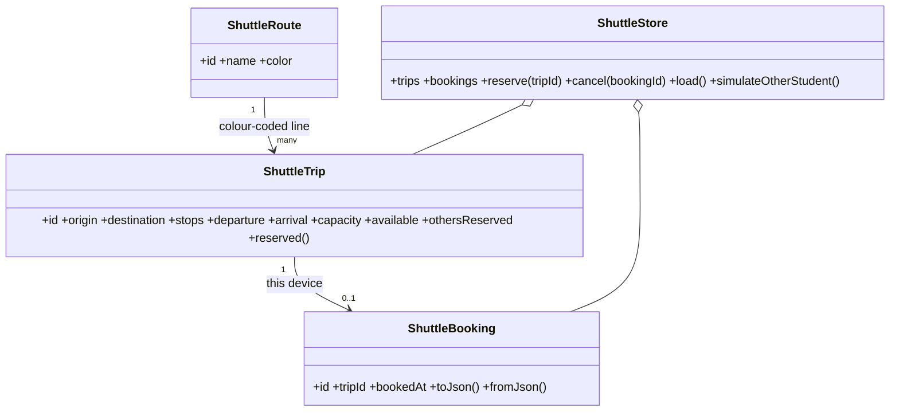

# Sprint 1 Deliverable Gap-Closure Implementation Plan

> **For agentic workers:** REQUIRED SUB-SKILL: Use superpowers:subagent-driven-development (recommended) or superpowers:executing-plans to implement this plan task-by-task. Steps use checkbox (`- [ ]`) syntax for tracking.

**Goal:** Close every gap between the three Sprint 1 case-study folders and their assigned briefs. Add nothing the briefs do not ask for.

**Architecture:** The work runs as seven parallel tracks, each owning a disjoint set of files:
- **A1:** CampusShuttle code
- **A2:** CampusShuttle Figma
- **B:** ML case
- **C1–C4:** ImmuniRemind documents

Every shared number is fixed once in the **Global Facts** section below, so tracks never have to wait for each other. A final integration task (D), run by the orchestrator, updates the READMEs, runs all verification and checks that numbers match across files.

**Tech Stack:**
- Flutter 3.47.5 at `/Users/utkarsh/Documents/.tools/flutter/bin/flutter`, with Provider and shared_preferences
- Python 3.14 with pandas, scikit-learn 1.9.1 (joblib included), and Streamlit
- Markdown and Mermaid documents
- The Figma MCP server (Starter plan, so connector calls are rate-limited)

**Spec:** the case brief pasted by the user on 2026-09-29, plus the approved gap triage from the same conversation. The brief lines that each task satisfies are quoted in that task's **Satisfies** field.

**Root:** `/Users/utkarsh/Documents/Sprint-1-Case-Studies` (abbreviated `ROOT`). Case folders:
- `ROOT/01_CampusShuttle_Case-10` (`CS`)
- `ROOT/02_Personalized-Academic-Support_Case-52` (`ML`)
- `ROOT/03_ImmuniRemind_Case-144` (`IR`)

---

## Global Constraints — the scope guard (every agent must obey)

1. **Allowed files only.** Edit or create only the files in your task's **Files** list. If you believe another file must change, stop and report. Do not edit it.
2. **Traceable to the brief.** Every addition must serve a brief line quoted in your task's **Satisfies** field. If you cannot point to one, do not add it.
3. **Explicitly forbidden, even if it seems helpful:**
   - new packages or dependencies
   - Android/iOS folders
   - Firebase or any backend
   - authentication
   - new app screens beyond those listed
   - splitting `main.dart` into multiple files
   - Navigator/router refactors
   - dark mode or theme refactors
   - GridSearchCV, Random Forest or threshold-tuning experiments
   - model selectors or prediction explanations in the Streamlit app
   - `.xlsx` files
   - rendered PNG/PDF diagram exports
   - viva documents for cases 10 and 144
   - edits to any README (the READMEs belong to Task D)
4. **Numbers are fixed.** Use the Global Facts values exactly. If one looks wrong, stop and report. Do not "correct" it.
5. **Honest labelling.** Any invented project data (actual durations, defect counts, workshop findings, pilot results) must sit under a heading or caption that contains the phrase **"Simulated for the case study"**.
6. **No git commits by agents.** The orchestrator commits after each track passes review, because parallel agents committing to one repo would collide on the git index.
7. **Priority.** **P1** tasks close an explicitly required gap. **P2** tasks strengthen an item the brief already covers. Within a track, finish all P1 steps before any P2 step. If time runs out, drop P2 steps and never P1.

---

## Global Facts (the single source of truth for shared numbers)

### ImmuniRemind dose fixture (12 doses)

This is a teaching fixture aligned to India UIP timepoints, *not clinical guidance*. Ages are in completed weeks (`floor(days_since_birth / 7)`); 9 months is taken as 39 weeks and 16 months as 69 weeks.

| Code | Dose | Min age (wk) = due age | Max age (wk) | Series predecessor (≥ 4 wk earlier) |
|---|---|---:|---:|---|
| D01 | BCG | 0 | 52 | — |
| D02 | OPV-0 | 0 | 2 | — |
| D03 | Penta-1 | 6 | 52 | — |
| D04 | OPV-1 | 6 | 260 | — |
| D05 | Penta-2 | 10 | 52 | D03 |
| D06 | OPV-2 | 10 | 260 | D04 |
| D07 | Penta-3 | 14 | 52 | D05 |
| D08 | OPV-3 | 14 | 260 | D06 |
| D09 | MR-1 | 39 | 260 | — |
| D10 | MR-2 | 69 | 260 | D09 |
| D11 | DPT Booster-1 | 69 | 260 | D07 |
| D12 | OPV Booster | 69 | 260 | D08 |

**Status rule** (for age `a`, min age `m`, max age `M`, when the dose is not yet administered):
- `a < 0` → **Invalid** (a future date of birth)
- `a < m` → **NotYetDue**
- `m ≤ a ≤ m+4` and `a ≤ M` → **Due**
- `m+4 < a ≤ M` → **Overdue** (catch-up allowed)
- `a > M` → **Missed** (no longer eligible; refer to the medical officer)
- `a > 260` → out of programme scope (the child is over 5 and is not registered)

**Reminder policy:**
- Advance SMS 3 days before the due date, at 09:00 local time
- Due-day SMS at 09:00
- On becoming Overdue, a catch-up SMS, repeated after 14 days, with a maximum of 2 catch-ups

### ImmuniRemind estimation

| Quantity | Formula | Result |
|---|---|---:|
| Total doses tracked | 36,000 × 12 | **432,000** |
| Children per post | 36,000 ÷ 40 | 900 |
| Doses per post | 432,000 ÷ 40 | 10,800 |
| Annual birth cohort (assumption: under-5s evenly spread over 5 years) | 36,000 ÷ 5 | 7,200 |
| Doses falling due per year (steady state) | 7,200 × 12 | 86,400 |
| Doses per month / per post per month | 86,400 ÷ 12; 7,200 ÷ 40 | 7,200; 180 |
| Routine SMS per year (2 per dose) | 86,400 × 2 | 172,800 |
| Catch-up SMS per year (assumption: 10% of doses overdue × 2 catch-ups) | 86,400 × 0.10 × 2 | 17,280 |
| Total SMS per year; per month; per post per month | 172,800 + 17,280; ÷ 12; ÷ 40 | 190,080; 15,840; 396 |
| Children missing ≥ 1 dose now | 36,000 × 0.23 | 8,280 |
| Children missing ≥ 1 dose at target | 36,000 × 0.10 | 3,600 |
| Reduction | 8,280 − 3,600; ÷ 8,280 | 4,680 children; 56.5% relative |
| Pilot children / doses tracked (5 posts) | 5 × 900; 4,500 × 12 | 4,500; 54,000 |
| Doses falling due during the 15-day pilot | 5 × 180 × 15/30 | 450 |
| Pilot registration effort (assumption: 4 min per child) | 4,500 × 4 = 18,000 min = 300 h | 37.5 staff-days |
| With 10 workers (2 per post) | 37.5 ÷ 10 | 3.75 days, so registration completes by pilot day 4 (project day 40) |

**Note on the 23% figure:** it is a **child-level** rate ("23% of children miss at least one scheduled vaccine"). It is not a dose-level rate. Never call it a "missed-dose level".

### ImmuniRemind CPM (planned — already verified correct)

| Task | Duration | ES | EF | LS | LF | Float |
|---|---:|---:|---:|---:|---:|---:|
| A Requirements | 6 | 0 | 6 | 0 | 6 | 0 |
| B Schedule rules | 4 | 6 | 10 | 12 | 16 | 6 |
| C Registration | 10 | 6 | 16 | 6 | 16 | 0 |
| D Schedule generator | 6 | 16 | 22 | 16 | 22 | 0 |
| E SMS reminders | 5 | 22 | 27 | 24 | 29 | 2 |
| F Supervisor dashboard | 7 | 22 | 29 | 22 | 29 | 0 |
| G Testing | 7 | 29 | 36 | 29 | 36 | 0 |
| H Pilot | 15 | 36 | 51 | 36 | 51 | 0 |

The critical path is A→C→D→F→G→H, 51 working days.

**Pilot milestones:**
- **P1, day 36:** go-live at 5 posts (training done)
- **P2, day 41:** all 4,500 children registered and the first reminder batch sent
- **P3, day 46:** mid-pilot metric review
- **P4, day 51:** pilot close and scale decision

### ImmuniRemind actual vs plan (Simulated for the case study)

**Actual durations:**
- As planned: A 6, D 6, E 5, G 7, H 15
- Over plan: **B 5 (+1)**, **C 12 (+2)**, **F 8 (+1)**

**Recomputed actual dates:** A 0–6, B 6–11, C 6–18, D 18–24, E 24–29, F 24–32, G 32–39, H 39–54.

**Variance:**
- Forecast finish is 54, a schedule variance of **+3 days (+5.9%)**.
- Status is taken at day 32. The work completed there was planned to finish at day 29, so SV(t) = 29 − 32 = **−3 days** and SPI(t) = 29 ÷ 32 = **0.906**.
- The overrun on B is absorbed by its float (6 → 5). The overruns on C and F are on the critical path.

**Corrective action (the approved option):**
1. Crash Testing from 7 to 5 days by adding one QA tester from the department IT cell. This recovers 2 days.
2. Overlap 1 day of pilot training with the last day of Testing. This recovers 1 day.

Forecast returns to **51**.
- **Proposed by:** the project manager.
- **Confirmed by:** the QA lead, who checks that the exit criteria are unchanged.
- **Approved by:** the **Project Sponsor (Municipal Health Officer)**, via the change control board.

**Pilot metrics, plan vs actual (Simulated for the case study):**

| Metric | Plan | Actual | Variance |
|---|---|---|---|
| Registration completeness | ≥ 98% | 97.2% | −0.8 pp |
| SMS delivery-confirmed within 24 h | ≥ 95% | 93.1% | −1.9 pp |
| Doses due in the pilot given within 7 days of the due date | ≥ 80% | 84.0% | +4.0 pp |
| Overdue doses among doses due during the pilot | ≤ 16% | 14.2% | −1.8 pp (better) |
| Worker usability task success | ≥ 4 of 5 | 4 of 5 | 0 |
| Privacy incidents | 0 | 0 | 0 |

**Scale rule:**
- **Go** if every threshold is met.
- **Conditional go** if at most 2 thresholds are missed, each by 3 pp or less, and each has a corrective action.
- **No-go** if there is any privacy incident or more than 2 misses.

**Outcome: Conditional go.** The corrective actions are phone-number verification at registration and a secondary gateway route. The decision is approved by the Municipal Health Officer and the steering committee.

### ImmuniRemind defect log (Simulated for the case study)

**Defects by phase:**
- Requirements review 6, Design review 5, Unit 14, Integration 9, System 7, UAT 4. That gives **45 pre-release**.
- Post-release (the first 15 pilot days): **3**.
- Total: **48**.

**Test execution:**

| Level | Cases run | Failed |
|---|---:|---:|
| Unit | 120 | 14 |
| Integration | 40 | 9 |
| System | 48 | 7 |
| UAT | 20 | 4 |

Each failure is one unique defect.

**Severity:** critical 2, high 9, medium 21, low 16 (total 48). The post-release defects are 0 critical, 1 high ("SMS delivery-receipt timeout not retried") and 2 medium.

**Module sizes (assumed):**

| Module | KLOC | Defects | Density (defects/KLOC) |
|---|---:|---:|---:|
| Registration | 3.0 | 12 | 4.0 |
| Schedule generator | 2.5 | 14 | 5.6 |
| SMS reminders | 2.0 | 10 | 5.0 |
| Supervisor dashboard | 3.5 | 9 | 2.57 |
| Auth/common | 1.0 | 3 | 3.0 |
| **Total** | **12.0** | **48** | **4.0** |

**Calculations:**
- **DRE** = 45 ÷ (45 + 3) = **93.75%**
- **Test-phase DRE** = (14 + 9 + 7 + 4) ÷ (34 + 3) = 34 ÷ 37 = **91.9%**

### ImmuniRemind NFR renumbering (Task C1 writes it; Task C2 uses it for traceability)

| ID | Name |
|---|---|
| NFR-01 | Reminder reliability — dispatch |
| NFR-02 | Reminder reliability — delivery |
| NFR-03 | Privacy — access control |
| NFR-04 | Privacy — data protection |
| NFR-05 | Auditability |
| NFR-06 | Performance |
| NFR-07 | Availability & recovery |
| NFR-08 | Usability |

The functional requirements keep their IDs, FR-01 to FR-12.

### ImmuniRemind risk ranking (sorted by exposure)

| Rank | Risk | P×I | Exposure |
|---:|---|---|---:|
| 1 | R3 | 4×4 | 16 |
| 2 | R4 | 4×4 | 16 |
| 3 | R1 | 3×5 | 15 |
| 4 | R2 | 3×5 | 15 |
| 5 | R5 | 3×4 | 12 |
| 6 | R6 | 3×4 | 12 |
| 7 | R8 | 3×4 | 12 |
| 8 | R9 | 2×5 | 10 |
| 9 | R10 | 3×3 | 9 |
| 10 | R7 | 2×4 | 8 |

The RMMM plans remain for the top three: R3, R4 and R1.

### ML figures (measured 2026-09-29 on `data/student-por.csv`)

| Figure | Value |
|---|---|
| Rows | 649 |
| Priority cases | 100 (15.4%) |
| Rows with G3 = 0 | 15 (8 of them have G2 > 0) |
| Absences | skew 2.02; 8 rows > 20; max 32 |
| Correlations | G1–G2 0.865, G1–G3 0.826, G2–G3 0.919, failures–G3 −0.393, studytime–G3 0.250 |
| Priority rate by school | GP 7.6% (n = 423), MS 30.1% (n = 226) |
| Priority rate by failures | 0: 9.3% (n = 549); 1: 45.7% (n = 70); 2: 50.0% (n = 16); 3: 64.3% (n = 14) |
| Failures documentation mismatch | `student.txt` says failures is "n if 1<=n<3, else 4", but the maximum observed value is 3 |

**Logistic holdout false negatives (source rows 111, 140, 143, 162):**
- All 4 have G2 ≥ 10 and 0 failures.
- 3 of the 4 have study time band 1.
- For comparison, the true positives average G2 7.38.

**Early-warning ablation (no G1/G2):** 5-fold CV logistic balanced accuracy ≈ 0.717, recall ≈ 0.59, ROC AUC ≈ 0.752.

**ML project title (proposed — the user must confirm or replace it before Task B5):** "EarlyNudge: Mid-Semester Academic Support Triage from Grade and Engagement Signals".

---

## Review Focus

These are the input classes and failure modes most likely to bite, and the task that pins each one with a test:

1. **Cancelling after other students have booked:** the count must return to `capacity − othersReserved`, not to the start-up value. Pinned in Task A1.
2. **A live timer left running after the store is disposed, or inside widget tests:** this causes "pending timer" failures. `dispose()` cancels the timer, and tests never call `startLiveUpdates`. Pinned in Task A1.
3. **Bookings saved before the Route-model change:** they must still load, and the JSON format stays unchanged. Covered by the existing persistence tests in Task A1.
4. **The Streamlit app when `outputs/logistic_model.joblib` is missing:** the app must show a clear error, not a traceback. Pinned in Task B3 (a load test) and in the Task B4 code.
5. **Numbers drifting between ImmuniRemind files** (432,000 / 51 → 54 → 51 / 48 defects / 93.75%): all files must agree. Pinned by the grep check in Task D.

---

## Track A1 — CampusShuttle app code (P1)

### Task A1: Fix the failing test, add live bookings from simulated students, a Route model and a reserved-seat display

**Satisfies:**
- "see the reserved-seat count update live as other students book"
- "Keep reserved-seat count synchronized between Trip Detail and My Bookings"
- "Prepare a simple data model for Route / Trip / Booking"
- "Responsive/working prototype"

**Files:**
- Modify: `CS/lib/main.dart`
- Modify: `CS/test/app_flow_test.dart`
- Modify: `CS/test/shuttle_store_test.dart`
- Modify: `CS/docs/APP_FLOW.md` (add a "Data model" and a "Live updates" section only)

**Interfaces:**
- Produces:
  - `class ShuttleRoute {String id; String name; Color color}`
  - `ShuttleStore.routes` (a `List<ShuttleRoute>`)
  - `ShuttleTrip.route` (a `ShuttleRoute`), `ShuttleTrip.color` (a getter), `ShuttleTrip.othersReserved` (an int), `ShuttleTrip.reserved` (a getter)
  - `ShuttleStore.simulateBooking(String) → bool`, `simulateCancellation(String) → bool`, `simulateOtherStudent() → bool`, `startLiveUpdates({Duration interval})`
  - `String? ShuttleStore.lastActivity`
  - Widget keys: `reserve-button`, `confirm-reserve`, `view-bookings`, `confirm-cancel`, `cancel-<bookingId>`

- [ ] **Step 1: Rewrite the widget test so it uses keys and completes the confirm dialogs**

Replace the body of `CS/test/app_flow_test.dart` with:

```dart
import 'package:flutter/material.dart';
import 'package:flutter_test/flutter_test.dart';
import 'package:provider/provider.dart';
import 'package:shared_preferences/shared_preferences.dart';
import 'package:campus_shuttle/main.dart';

Future<ShuttleStore> _pumpApp(WidgetTester tester) async {
  SharedPreferences.setMockInitialValues({});
  final store = ShuttleStore();
  await store.load();
  await tester.pumpWidget(ChangeNotifierProvider<ShuttleStore>.value(
    value: store,
    child: const CampusShuttleApp(),
  ));
  await tester.pumpAndSettle();
  return store;
}

Future<void> _tapKey(WidgetTester tester, String key) async {
  final finder = find.byKey(ValueKey(key));
  await tester.ensureVisible(finder);
  await tester.tap(finder);
  await tester.pumpAndSettle();
}

void main() {
  TestWidgetsFlutterBinding.ensureInitialized();

  testWidgets('rider can inspect a route, reserve it, and cancel it',
      (tester) async {
    final store = await _pumpApp(tester);

    expect(find.text('Scheduled departures'), findsOneWidget);
    await _tapKey(tester, 'trip-card-north-0815');
    expect(find.text('Stops along this route'), findsOneWidget);

    await _tapKey(tester, 'reserve-button');
    expect(find.text('Confirm your seat'), findsOneWidget);
    await _tapKey(tester, 'confirm-reserve');
    expect(find.text('Booking confirmed'), findsOneWidget);
    expect(store.trip('north-0815').available, 7);

    await _tapKey(tester, 'view-bookings');
    expect(find.text('1 reservation'), findsOneWidget);

    await _tapKey(tester, 'cancel-${store.bookings.single.id}');
    expect(find.text('Cancel this booking?'), findsOneWidget);
    await _tapKey(tester, 'confirm-cancel');
    expect(find.text('No bookings yet'), findsOneWidget);
    expect(store.trip('north-0815').available, 8);
  });

  testWidgets('seat count updates live on Trip Detail and My Bookings',
      (tester) async {
    final store = await _pumpApp(tester);

    await _tapKey(tester, 'trip-card-north-0815');
    expect(find.text('8 of 24 left'), findsOneWidget);
    expect(find.text('16 reserved · 8 left of 24'), findsOneWidget);

    store.simulateBooking('north-0815');
    await tester.pumpAndSettle();
    expect(find.text('7 of 24 left'), findsOneWidget);
    expect(find.text('17 reserved · 7 left of 24'), findsOneWidget);

    await _tapKey(tester, 'reserve-button');
    await _tapKey(tester, 'confirm-reserve');
    await _tapKey(tester, 'view-bookings');
    expect(find.text('6 of 24 left'), findsOneWidget);

    store.simulateCancellation('north-0815');
    await tester.pumpAndSettle();
    expect(find.text('7 of 24 left'), findsOneWidget);
  });
}
```

- [ ] **Step 2: Add store tests for the simulation invariants**

Append these tests inside `main()` of `CS/test/shuttle_store_test.dart`, and add `import 'dart:math';` at the top:

```dart
  test('simulated students keep the seat invariant for every trip', () async {
    final store = ShuttleStore(random: Random(7));
    await store.load();
    store.reserve('north-0815');
    for (var i = 0; i < 300; i++) {
      store.simulateOtherStudent();
    }
    for (final trip in store.trips) {
      final mine = store.isBooked(trip.id) ? 1 : 0;
      expect(trip.available + trip.othersReserved + mine, trip.capacity,
          reason: trip.id);
      expect(trip.available, greaterThanOrEqualTo(0), reason: trip.id);
      expect(trip.reserved, trip.capacity - trip.available, reason: trip.id);
    }
  });

  test('cancelling after other students booked restores exactly one seat',
      () async {
    final store = ShuttleStore();
    await store.load();
    store.reserve('west-0915'); // 12 -> 11
    store.simulateBooking('west-0915'); // 11 -> 10
    store.simulateBooking('west-0915'); // 10 -> 9
    store.cancel(store.bookings.single.id);
    expect(store.trip('west-0915').available, 10);
  });

  test('other students never take the last seat', () async {
    final store = ShuttleStore();
    await store.load();
    // north-0945 starts with 2 available.
    expect(store.simulateBooking('north-0945'), isTrue);
    expect(store.simulateBooking('north-0945'), isFalse);
    expect(store.trip('north-0945').available, 1);
  });

  test('live updates stop when the store is disposed', () async {
    final store = ShuttleStore();
    await store.load();
    store.startLiveUpdates(interval: const Duration(milliseconds: 10));
    store.dispose();
    await Future<void>.delayed(const Duration(milliseconds: 40));
  });
```

- [ ] **Step 3: Run the tests and confirm they fail**

Run: `cd CS && /Users/utkarsh/Documents/.tools/flutter/bin/flutter test`
Expected: compile errors about `random:`, `simulateOtherStudent`, `othersReserved` and `reserved`.

- [ ] **Step 4: Add the Route model and the simulation to the store in `CS/lib/main.dart`**

1. Add `import 'dart:math';` next to the existing imports.

2. Insert this class above `ShuttleTrip`:

```dart
class ShuttleRoute {
  const ShuttleRoute(
      {required this.id, required this.name, required this.color});

  final String id;
  final String name;
  final Color color;
}
```

3. Change `ShuttleTrip`:
   - Replace the `required this.color` parameter and the `final Color color;` field with `required this.route` and `final ShuttleRoute route;`. The old `final String route;` is removed.
   - Change the initializer to `: initialAvailable = available, othersReserved = capacity - available;`
   - Add:

```dart
  int othersReserved;
  Color get color => route.color;
  int get reserved => capacity - available;
```

4. In `ShuttleStore`, add these static routes and change each trip literal to `route: northLoop` / `residences` / `westConnector`, deleting its `color:` line:

```dart
  static const northLoop = ShuttleRoute(
      id: 'north', name: 'North Loop', color: Color(0xFF2F6FED));
  static const residences = ShuttleRoute(
      id: 'res', name: 'Residences', color: Color(0xFF149477));
  static const westConnector = ShuttleRoute(
      id: 'west', name: 'West Connector', color: Color(0xFFE2782D));
  static const routes = [northLoop, residences, westConnector];
```

5. Add the constructor and fields:

```dart
  ShuttleStore({Random? random}) : _random = random ?? Random();

  final Random _random;
  Timer? _liveTimer;
  String? lastActivity;
```

6. In `load()`, change the reset loop to:

```dart
    for (final trip in _trips) {
      trip.available = trip.initialAvailable;
      trip.othersReserved = trip.capacity - trip.initialAvailable;
    }
```

7. In `cancel()`, replace `if (selected.available < selected.initialAvailable) selected.available++;` with:

```dart
    selected.available = selected.capacity - selected.othersReserved;
```

8. Add these methods to `ShuttleStore`:

```dart
  /// Simulated booking by another student. Leaves the last seat for the demo user.
  bool simulateBooking(String tripId) {
    final selected = trip(tripId);
    if (!ready || selected.available <= 1) return false;
    selected.available--;
    selected.othersReserved++;
    lastActivity =
        'Another student booked ${selected.route.name} · ${selected.departure}';
    notifyListeners();
    return true;
  }

  /// Simulated cancellation by another student.
  bool simulateCancellation(String tripId) {
    final selected = trip(tripId);
    if (!ready || selected.othersReserved <= 0) return false;
    selected.othersReserved--;
    selected.available++;
    lastActivity =
        'Another student cancelled ${selected.route.name} · ${selected.departure}';
    notifyListeners();
    return true;
  }

  bool simulateOtherStudent() {
    if (!ready) return false;
    final selected = _trips[_random.nextInt(_trips.length)];
    return _random.nextBool()
        ? simulateBooking(selected.id)
        : simulateCancellation(selected.id);
  }

  void startLiveUpdates({Duration interval = const Duration(seconds: 6)}) {
    _liveTimer?.cancel();
    _liveTimer = Timer.periodic(interval, (_) => simulateOtherStudent());
  }

  @override
  void dispose() {
    _liveTimer?.cancel();
    super.dispose();
  }
```

9. In `main()`, change `create: (_) => ShuttleStore()..load(),` to `create: (_) => ShuttleStore()..load()..startLiveUpdates(),`.

- [ ] **Step 5: Update the UI in `CS/lib/main.dart`**

1. Replace every use of `trip.route` as a string with `trip.route.name`. These appear at the current lines 442, 444, 656, 784, 874, 902, 1103 and 1152. The comparison on line 442 becomes `trip.route.name == _route`.

2. In the filter chips (lines 504–509), replace the literal list with `['All routes', ...ShuttleStore.routes.map((r) => r.name)]`. Give each route chip a colour dot:

```dart
avatar: route == 'All routes'
    ? null
    : CircleAvatar(
        radius: 5,
        backgroundColor: ShuttleStore.routes
            .firstWhere((r) => r.name == route)
            .color),
```

3. In `_RouteLegend.build`, return a non-const `Wrap` whose children are `ShuttleStore.routes.map((r) => _LegendDot(color: r.color, label: r.name)).toList()`.

4. In `_SeatBadge`, change the text to `'${trip.available} of ${trip.capacity} left'`.

5. Add this widget. In `TripDetail`, insert `_SeatMeter(trip: trip)` directly after the `SizedBox(height: 22)` that follows the header row, followed by `const SizedBox(height: 16)`.

```dart
class _SeatMeter extends StatelessWidget {
  const _SeatMeter({required this.trip});
  final ShuttleTrip trip;
  @override
  Widget build(BuildContext context) => Card(
        child: Padding(
          padding: const EdgeInsets.all(18),
          child: Column(crossAxisAlignment: CrossAxisAlignment.start, children: [
            Text(
                '${trip.reserved} reserved · ${trip.available} left of ${trip.capacity}',
                style: const TextStyle(fontWeight: FontWeight.w700)),
            const SizedBox(height: 10),
            LinearProgressIndicator(
              value: trip.reserved / trip.capacity,
              color: trip.color,
              backgroundColor: trip.color.withValues(alpha: .15),
              minHeight: 8,
              borderRadius: BorderRadius.circular(8),
            ),
          ]),
        ),
      );
}
```

6. Add a live-activity strip. In `Timetable`, insert `_LiveActivity(store: store)` directly after `const _DemoNotice()` and its `SizedBox`, followed by `const SizedBox(height: 14)`.

```dart
class _LiveActivity extends StatelessWidget {
  const _LiveActivity({required this.store});
  final ShuttleStore store;
  @override
  Widget build(BuildContext context) => Row(children: [
        const Icon(Icons.sensors_rounded, size: 18, color: Color(0xFF067647)),
        const SizedBox(width: 8),
        Expanded(
          child: Text(
            store.lastActivity ??
                'Live · seat counts update as other students book (simulated)',
            style: const TextStyle(fontSize: 12, color: Color(0xFF344054)),
          ),
        ),
      ]);
}
```

7. In `_BookingCard.build`:
   - Change `context.read<ShuttleStore>()` to `context.watch<ShuttleStore>()`.
   - Add `const SizedBox(height: 8), _SeatBadge(trip: trip),` under the origin→destination text in the `details` column.
   - Give the Cancel `TextButton.icon` the argument `key: ValueKey('cancel-${booking.id}'),`.

8. Add keys to these buttons:
   - The Trip Detail `FilledButton.icon` that reserves gets `key: const ValueKey('reserve-button')`.
   - The reserve dialog's `FilledButton` ("Reserve seat") gets `key: const ValueKey('confirm-reserve')`.
   - The confirmation dialog's `FilledButton.icon` ("View My Bookings") gets `key: const ValueKey('view-bookings')`.
   - The cancel dialog's `FilledButton` ("Cancel booking") gets `key: const ValueKey('confirm-cancel')`.

- [ ] **Step 6: Run the tests and the analyzer, and confirm both pass**

Run: `cd CS && /Users/utkarsh/Documents/.tools/flutter/bin/flutter test && /Users/utkarsh/Documents/.tools/flutter/bin/flutter analyze`
Expected: all 11 tests pass, and the analyzer prints "No issues found!"

- [ ] **Step 7: Document the model and the live updates in `CS/docs/APP_FLOW.md`**

Append these two sections exactly:

````markdown
## Data model



Invariant for every trip: `available + othersReserved + (booked on this device ? 1 : 0) = capacity`.

## Live updates

The brief asks for seat counts that update live as other students book. With no backend in this prototype, `ShuttleStore.startLiveUpdates()` runs a timer that simulates another student booking or cancelling every 6 seconds and calls `notifyListeners()`. Timetable, Trip Detail and My Bookings all rebuild at the same moment. That is the synchronisation Provider provides. Simulated students never take a trip's last seat, so the demo user can always book. In production, the timer would be replaced by a server stream (for example a Firestore snapshot listener) that feeds the same store.
````

---

## Track A2 — CampusShuttle Figma design (P1)

### Task A2: Build the Figma file — a styles page and a linked five-frame flow

**Satisfies:**
- "Figma: Clean guided flow; Progress cues; Timetable → trip detail → booking → confirmation journey"
- Deliverable "Figma design"
- "Route-colour coding for each shuttle line"

**Files:**
- Create: the Figma file "CampusShuttle — Case 10" (in the user's team)
- Create: `CS/design/FIGMA.md`

**Rules:**
- Load the `figma:figma-create-new-file` skill before `create_new_file`, and the `figma:figma-use` skill (plus `figma:figma-generate-design`) before any `use_figma` call.
- The Starter plan is rate-limited. Build each page or frame in **one** `use_figma` call. Target 10 or fewer Figma calls in total, and do not retry a failing call more than once.
- Use only the content listed below. It mirrors the app after Task A1. Invent no features.

- [ ] **Step 1: Create the file.** Create "CampusShuttle — Case 10" with two pages: `01 Styles` and `02 Flow`.

- [ ] **Step 2: Build the `01 Styles` page (one call).**
  - **Colour styles:**
    - Primary `#2456C7`
    - North Loop `#2F6FED`, Residences `#149477`, West Connector `#E2782D`
    - Surface `#F5F7FB`, Card `#FFFFFF`, Border `#E8ECF3`
    - Text `#182230`, Muted `#667085`, Success `#067647`, Low-seat `#FFF1E8`
  - **Text styles (Inter or Roboto):**
    - Display 34/800
    - Title 20/700
    - Body 14/400
    - Caption 12/400
    - Label 10/700 uppercase, letter-spacing 0.7
  - A short note explaining why: Material 3 seed colour, and one colour per route so each line is recognisable at a glance.

- [ ] **Step 3: Build the `02 Flow` page — five 390×844 frames, one call each.** Every frame has a progress strip reading "BOOKING JOURNEY · STEP n OF 4", with four segments labelled Timetable / Trip details / Reserve seat / Confirmation. Segments up to step n are filled with Primary.
  1. **`1 Timetable` (step 1):**
     - Header "Plan a campus ride"
     - Live strip "Live · seat counts update as other students book (simulated)"
     - Route filter chips with colour dots
     - Four trip cards, each with a left colour bar, route name, origin → destination, departure, "Arrives …" and a seat badge:
       - North Loop 8:15 AM, North Gate → Main Campus, "8 of 24 left"
       - Residences 8:45 AM, Maple Residence → Main Campus, "4 of 20 left"
       - West Connector 9:15 AM, West Parking → Engineering, "12 of 24 left"
       - North Loop 9:45 AM, "2 of 24 left" (low-seat colour)
     - A route legend
  2. **`2 Trip detail` (step 2):**
     - "← Back to timetable"
     - North Loop header with colour bar and badge "8 of 24 left"
     - Seat meter "16 reserved · 8 left of 24" with a route-coloured progress bar
     - Departure 8:15 AM North Gate → Arrival 8:35 AM Main Campus
     - Stop sequence North Gate · Library Square · Science Block · Main Campus, drawn with route-colour dots, marked PICKUP and DESTINATION
     - A "Reserve a seat" button
  3. **`3 Reserve` (step 3):** frame 2 dimmed, with a dialog on top:
     - Title "Confirm your seat"
     - "Step 3 of 4 · Reserve"
     - Trip summary
     - Buttons "Go back" and "Reserve seat"
  4. **`4 Confirmation` (step 4):**
     - A success icon and "Booking confirmed"
     - "Step 4 of 4 · Confirmation"
     - North Loop at 8:15 AM, "7 of 24 left"
     - Booking ID `CS-1727600000000`
     - Buttons "Stay on trip" and "View My Bookings"
  5. **`5 My Bookings` (step 4):**
     - Title "My Bookings", "1 reservation"
     - A booking card with colour bar, North Loop, North Gate → Main Campus, 8:15 AM, "7 of 24 left" and a "Cancel" button
     - The caption "Cancellation returns the seat to availability"

- [ ] **Step 4: Add prototype links (one call).** Link the elements so the prototype walks through the frames:
  - trip card (1) → frame 2
  - "Reserve a seat" (2) → frame 3
  - "Reserve seat" (3) → frame 4
  - "View My Bookings" (4) → frame 5
  - "Cancel" (5) → frame 1

  Set frame 1 as the prototype starting point.

- [ ] **Step 5: Verify.** Take one `get_screenshot` of the `02 Flow` page. Check that all five frames, the progress strips and the three route colours are visible.

- [ ] **Step 6: Record the file.** Create `CS/design/FIGMA.md` containing:
  - the Figma file URL and the prototype URL
  - the frame list, as above
  - the styles summary
  - one sentence noting that `campusshuttle-flow.svg` is the earlier static export

---

## Track B — ML Case 52 (tasks run in order within the track)

### Task B1 (P1): Replace the misplaced venv and remove caches

**Satisfies:** deliverable "Source Code" (a clean, reproducible submission).

**Files:**
- Delete: `ML/path/` (a 528 MB virtual environment)
- Delete: `ML/__pycache__/`, `ML/src/__pycache__/`, `ML/tests/__pycache__/`
- Create: `ML/.venv/` (already covered by `.gitignore`)

- [ ] **Step 1: Build `.venv` first, so the project can still run**

Run:
```bash
cd ML && python3 -m venv .venv && .venv/bin/python -m pip install -q -r requirements.txt && .venv/bin/python -m unittest discover tests
```
Expected: `Ran 3 tests … OK`

- [ ] **Step 2: Delete the old environment and the caches**

Run: `cd ML && rm -rf path __pycache__ src/__pycache__ tests/__pycache__ && ls -a`
Expected: `path` and `__pycache__` are no longer listed.

### Task B2 (P1 data quality, P2 charts): Record data-quality issues and add bias-relevant EDA

**Satisfies:**
- "Record data-quality issues"
- "Produce meaningful visualizations. Record observations rather than only showing charts"
- "Explain limitations and possible bias/data-quality issues"

**Files:**
- Modify: `ML/src/eda.py`
- Modify: `ML/data/README.md` (the "Data quality" section only)
- Create: `ML/tests/test_eda.py`
- Generated: `ML/outputs/eda_summary.md`, `ML/outputs/priority_by_school.svg`, `ML/outputs/priority_by_failures.svg`

- [ ] **Step 1: Write the failing test** in `ML/tests/test_eda.py`:

```python
"""EDA evidence must record data-quality issues and subgroup rates."""
from __future__ import annotations

import sys
import unittest
from pathlib import Path

ROOT = Path(__file__).resolve().parents[1]
sys.path.insert(0, str(ROOT / "src"))

import eda  # noqa: E402


class EdaEvidence(unittest.TestCase):
    @classmethod
    def setUpClass(cls):
        eda.run()
        cls.summary = (ROOT / "outputs" / "eda_summary.md").read_text(encoding="utf-8")

    def test_new_charts_exist(self):
        for name in ["priority_by_school.svg", "priority_by_failures.svg"]:
            self.assertGreater((ROOT / "outputs" / name).stat().st_size, 100, name)

    def test_data_quality_section_records_issues(self):
        self.assertIn("## Data-quality issues", self.summary)
        self.assertIn("15 rows have G3 = 0", self.summary)
        self.assertIn("skew 2.02", self.summary)
        self.assertIn("n if 1<=n<3, else 4", self.summary)

    def test_subgroup_and_correlation_findings(self):
        self.assertIn("30.1%", self.summary)
        self.assertIn("7.6%", self.summary)
        self.assertIn("0.919", self.summary)


if __name__ == "__main__":
    unittest.main(verbosity=2)
```

- [ ] **Step 2: Run the test and confirm it fails**

Run: `cd ML && .venv/bin/python -m unittest tests.test_eda -v`
Expected: FAIL on the missing charts and text.

- [ ] **Step 3: Extend `run()` in `ML/src/eda.py`**

Add these charts after the existing three `write_bar_svg` calls:

```python
    school_rates = frame.groupby("school")[TARGET].mean().mul(100)
    school_sizes = frame["school"].value_counts()
    write_bar_svg(
        OUT / "priority_by_school.svg",
        "Support-priority rate by school",
        [f"{s} (n={int(school_sizes[s])})" for s in ["GP", "MS"]],
        [float(school_rates[s]) for s in ["GP", "MS"]],
        "Priority rate (%)",
        "#7A4CC2",
        "%",
    )
    failure_rates = frame.groupby("failures")[TARGET].mean().mul(100)
    write_bar_svg(
        OUT / "priority_by_failures.svg",
        "Support-priority rate by previous class failures",
        [str(v) for v in failure_rates.index],
        [float(v) for v in failure_rates.values],
        "Priority rate (%)",
        "#C2413B",
        "%",
    )
    corr = frame[NUMERIC_COLUMNS].corr().round(3)
    zero_g3 = int((frame["G3"] == 0).sum())
    zero_g3_with_g2 = int(((frame["G3"] == 0) & (frame["G2"] > 0)).sum())
    absences_skew = float(frame["absences"].skew())
    high_absence = int((frame["absences"] > 20).sum())
```

Define this at module level:

```python
NUMERIC_COLUMNS = ["G1", "G2", "G3", "studytime", "failures", "absences", "traveltime"]
```

Use it in place of the literal list inside `numeric = frame[...]`.

Then insert these lines into `lines`, directly before `"## Observations"`:

```python
        "## Data-quality issues",
        "",
        f"- {zero_g3} rows have G3 = 0 ({zero_g3_with_g2} of them with G2 > 0). These look like students who left or missed the final assessment rather than true zero attainment, so they are noisy positive labels. They are kept, because excluding them would hide real disengagement, and flagged as a limitation.",
        f"- Absences are right-skewed (skew {absences_skew:.2f}); {high_absence} rows exceed 20 and the maximum is {int(frame['absences'].max())}. Standard scaling keeps them, and logistic regression is sensitive to such outliers.",
        f"- G1 and G2 are strongly collinear (r = {corr.loc['G1', 'G2']:.3f}) and G2 correlates {corr.loc['G2', 'G3']:.3f} with G3, so coefficients for G1 and G2 should not be read independently.",
        "- `studytime` and `traveltime` are ordinal bands (1–4), not hours. They are scaled as ordered numbers, which assumes equal spacing between bands.",
        f"- `student.txt` documents failures as `n if 1<=n<3, else 4`, but the maximum observed value is {int(frame['failures'].max())}. Value 3 is therefore treated as '3 or more'.",
        "- G1 and G2 are quoted strings in the raw CSV, but they parse cleanly as integers. No missing values or exact duplicates are present.",
        "",
        "## Correlation with final grade G3",
        "",
        "| Feature | r with G3 |",
        "| --- | ---: |",
        *[f"| {c} | {corr.loc[c, 'G3']:.3f} |" for c in NUMERIC_COLUMNS if c != "G3"],
        "",
```

Append these observations to the Observations list:

```python
        f"- Priority rate differs sharply by school: GP {school_rates['GP']:.1f}% vs MS {school_rates['MS']:.1f}%. `school` is not a model input, but any input correlated with school can carry this gap, so errors must be checked per school (see the report's bias section).",
        f"- Priority rate rises with previous failures: {', '.join(f'{int(k)} → {v:.1f}%' for k, v in failure_rates.items())}.",
```

Append these image links at the end:

```python
        "",
        "",
        "",
        "",
```

- [ ] **Step 4: Run the tests and confirm they pass**

Run: `cd ML && .venv/bin/python -m unittest discover tests -v`
Expected: all tests pass.

- [ ] **Step 5: Mirror the data-quality bullets in `ML/data/README.md`**

Replace the "Data quality" bullet list with the six facts above, using the literal values from Global Facts. Keep the existing lines on rows, columns and class counts.

### Task B3 (P1): Overfitting evidence, the early-warning experiment, the error profile, and saving the evaluated model

**Satisfies:**
- "Compare meaningful experiments"
- "Explain overfitting and how you would detect it"
- "Analyse errors"
- "Prepare the Streamlit input → preprocessing → model → output flow"

**Files:**
- Modify: `ML/src/modeling.py` (`make_preprocessor` and `make_logistic_model` gain parameters; add `EARLY_NUMERIC_FEATURES`)
- Modify: `ML/src/train_evaluate.py`
- Modify: `ML/tests/test_validate_demo.py`
- Generated: `ML/outputs/model_comparison.json`, `ML/outputs/holdout_error_analysis.csv`, `ML/outputs/logistic_model.joblib`

**Interfaces:**
- `make_preprocessor(numeric: list[str] = NUMERIC_FEATURES, categorical: list[str] = CATEGORICAL_FEATURES) -> ColumnTransformer`
- `make_logistic_model(numeric: list[str] = NUMERIC_FEATURES, categorical: list[str] = CATEGORICAL_FEATURES) -> Pipeline`
- `EARLY_NUMERIC_FEATURES = ["studytime", "failures", "absences", "traveltime"]`
- `MODEL_PATH = ROOT / "outputs" / "logistic_model.joblib"` (defined in `modeling.py`)
- New JSON keys: `models[*].features`, `models[*].cv_mean_train_balanced_accuracy`, `models[*].overfit_gap_balanced_accuracy`, a top-level `tree_depth_curve` (list of `{depth, train_balanced_accuracy, validation_balanced_accuracy}`), and a top-level `logistic_error_profile`.

- [ ] **Step 1: Write the failing tests.** Replace the `expected` list's model assertion and add these tests in `ML/tests/test_validate_demo.py`:

```python
    def test_model_comparison_contains_experiments(self):
        result = json.loads(
            (ROOT / "outputs" / "model_comparison.json").read_text(encoding="utf-8")
        )
        self.assertEqual(
            set(result["models"]),
            {
                "Majority baseline",
                "Logistic regression",
                "Decision tree",
                "Logistic regression — no G1/G2 (early warning)",
            },
        )
        for values in result["models"].values():
            self.assertIn("confusion_matrix_tn_fp_fn_tp", values)
            self.assertIn("cv_mean_train_balanced_accuracy", values)
            self.assertIn("overfit_gap_balanced_accuracy", values)
        early = result["models"]["Logistic regression — no G1/G2 (early warning)"]
        self.assertNotIn("G1", early["features"])
        self.assertNotIn("G2", early["features"])
        self.assertLess(
            early["holdout_balanced_accuracy"],
            result["models"]["Logistic regression"]["holdout_balanced_accuracy"],
        )
        self.assertEqual([p["depth"] for p in result["tree_depth_curve"]], list(range(1, 11)))
        self.assertEqual(result["logistic_error_profile"]["false_negative"]["count"], 4)

    def test_saved_model_loads_and_predicts(self):
        import joblib
        import pandas as pd

        model = joblib.load(ROOT / "outputs" / "logistic_model.joblib")
        row = pd.DataFrame([{
            "G1": 8, "G2": 8, "studytime": 1, "failures": 1, "absences": 10,
            "traveltime": 3, "schoolsup": "no", "famsup": "no",
            "internet": "no", "higher": "yes",
        }])
        probability = float(model.predict_proba(row)[0, 1])
        self.assertGreater(probability, 0.5)
```

Delete the old `test_model_comparison_contains_two_models_and_baseline`, and add `"logistic_model.joblib"` to the `expected` list in `test_generated_evidence_is_complete`.

- [ ] **Step 2: Run the tests and confirm they fail**

Run: `cd ML && .venv/bin/python -m unittest tests.test_validate_demo -v`
Expected: FAIL (the model set differs and the joblib file is missing).

- [ ] **Step 3: Parameterise `modeling.py`**

```python
EARLY_NUMERIC_FEATURES = ["studytime", "failures", "absences", "traveltime"]
MODEL_PATH = ROOT / "outputs" / "logistic_model.joblib"


def make_preprocessor(
    numeric: list[str] = NUMERIC_FEATURES,
    categorical: list[str] = CATEGORICAL_FEATURES,
) -> ColumnTransformer:
    numeric_steps = Pipeline([
        ("impute", SimpleImputer(strategy="median")),
        ("scale", StandardScaler()),
    ])
    categorical_steps = Pipeline([
        ("impute", SimpleImputer(strategy="most_frequent")),
        ("encode", OneHotEncoder(handle_unknown="ignore")),
    ])
    return ColumnTransformer([
        ("numeric", numeric_steps, numeric),
        ("categorical", categorical_steps, categorical),
    ])


def make_logistic_model(
    numeric: list[str] = NUMERIC_FEATURES,
    categorical: list[str] = CATEGORICAL_FEATURES,
) -> Pipeline:
    return Pipeline([
        ("preprocess", make_preprocessor(numeric, categorical)),
        ("model", LogisticRegression(
            max_iter=2000,
            class_weight="balanced",
            random_state=52,
        )),
    ])
```

`make_tree_model` stays unchanged (it calls `make_preprocessor()` with the defaults).

- [ ] **Step 4: Extend `train_evaluate.py`**

1. Imports: add `import joblib`, `from sklearn.tree import DecisionTreeClassifier`, and from `modeling` also import `CATEGORICAL_FEATURES`, `EARLY_NUMERIC_FEATURES`, `MODEL_PATH` and `NUMERIC_FEATURES`.

2. Replace the `models` dict with `(key, features, model)` tuples, so the existing CSV column names stay stable:

```python
    early_features = EARLY_NUMERIC_FEATURES + CATEGORICAL_FEATURES
    models = {
        "Majority baseline": ("majority_baseline", FEATURES, _dummy_model()),
        "Logistic regression": ("logistic_regression", FEATURES, make_logistic_model()),
        "Decision tree": ("decision_tree", FEATURES, make_tree_model()),
        "Logistic regression — no G1/G2 (early warning)": (
            "logistic_no_grades",
            early_features,
            make_logistic_model(EARLY_NUMERIC_FEATURES, CATEGORICAL_FEATURES),
        ),
    }
```

3. In the loop, change to `for name, (key, features, model) in models.items():`. Call `cross_validate(..., return_train_score=True)`. Add these entries to the model's dict:

```python
            "features": features,
            "cv_mean_train_balanced_accuracy": round(float(cv["train_balanced_accuracy"].mean()), 4),
            "overfit_gap_balanced_accuracy": round(
                float(cv["train_balanced_accuracy"].mean() - cv["test_balanced_accuracy"].mean()), 4
            ),
```

   Delete the old `key = name.lower().replace(" ", "_")` line.

4. After the loop, add:

```python
    depth_curve = []
    for depth in range(1, 11):
        tree = Pipeline([
            ("preprocess", make_preprocessor()),
            ("model", DecisionTreeClassifier(
                max_depth=depth, min_samples_leaf=10,
                class_weight="balanced", random_state=52,
            )),
        ])
        scores = cross_validate(
            tree, x_train, y_train, cv=folds,
            scoring="balanced_accuracy", return_train_score=True,
        )
        depth_curve.append({
            "depth": depth,
            "train_balanced_accuracy": round(float(scores["train_score"].mean()), 4),
            "validation_balanced_accuracy": round(float(scores["test_score"].mean()), 4),
        })
    result["tree_depth_curve"] = depth_curve

    profile = {}
    for label in ["false_negative", "false_positive"]:
        rows = error_frame[error_frame["logistic_error_type"] == label]
        profile[label] = {
            "count": int(len(rows)),
            "mean": {c: round(float(rows[c].mean()), 2) for c in NUMERIC_FEATURES},
        }
    true_pos = error_frame[(y_test == 1) & (error_frame["logistic_regression_prediction"] == 1)]
    profile["true_positive"] = {
        "count": int(len(true_pos)),
        "mean": {c: round(float(true_pos[c].mean()), 2) for c in NUMERIC_FEATURES},
    }
    result["logistic_error_profile"] = profile

    joblib.dump(models["Logistic regression"][2], MODEL_PATH)
```

   Move the `logistic_error_type` block above this code if it is not already there.

- [ ] **Step 5: Regenerate the outputs and run all tests**

Run: `cd ML && .venv/bin/python src/eda.py && .venv/bin/python src/train_evaluate.py > /dev/null && .venv/bin/python -m unittest discover tests -v`
Expected: all tests pass. `model_comparison.json` now has 4 models, `tree_depth_curve` and `logistic_error_profile`. The Logistic regression holdout numbers are unchanged from before (balanced accuracy 0.8729).

### Task B4 (P2): Make the app use the evaluated model and show the new evidence

**Satisfies:**
- "Build a functional Streamlit application with understandable inputs and outputs"
- The consistency of "Streamlit input → preprocessing → model → output flow"

**Files:** Modify: `ML/app.py`

- [ ] **Step 1: Load the saved model instead of retraining.** Replace `fitted_model()` with:

```python
@st.cache_resource
def fitted_model():
    if not MODEL_PATH.exists():
        return None
    return joblib.load(MODEL_PATH)
```

Add `import joblib`, and add `MODEL_PATH` to the `src.modeling` import. Remove `make_logistic_model` from the import if it becomes unused.

In the `if submitted:` block, start with:

```python
        model = fitted_model()
        if model is None:
            st.error("Model file missing. Run `python3 src/train_evaluate.py` first.")
            st.stop()
```

Then use `model.predict_proba(...)`.

- [ ] **Step 2: Show the overfitting gap in the comparison table.** In the rows loop, add these columns after "ROC AUC":

```python
                "CV train BA": result["cv_mean_train_balanced_accuracy"],
                "Train−val gap": result["overfit_gap_balanced_accuracy"],
```

- [ ] **Step 3: Add a caption under the table:**

```python
        st.caption(
            "The app uses the exact logistic-regression pipeline evaluated above (trained on the 75% partition and saved to outputs/logistic_model.joblib). "
            "The early-warning row drops G1/G2 to show how much the model depends on earlier grades."
        )
```

- [ ] **Step 4: Smoke-test the app**

Run: `cd ML && (.venv/bin/streamlit run app.py --server.headless true --server.port 8765 > /dev/null 2>&1 &) ; sleep 12; curl -s -o /dev/null -w "%{http_code}\n" http://localhost:8765; pkill -f "server.port 8765"`
Expected: `200`

Then run: `cd ML && .venv/bin/python -c "import ast,sys; ast.parse(open('app.py').read())"`
Expected: no output.

### Task B5 (P1): Title, problem framing, results, overfitting, error and bias write-up

**Satisfies:**
- "Create a student-formulated project title"
- "Decide what the system should actually output"
- "Interpret results. Analyse errors. Explain limitations"
- Deliverables "Final Report" and "Viva Evidence"

**Files:**
- Modify: `ML/docs/PROJECT_REPORT.md`
- Modify: `ML/docs/VIVA_AND_PRESENTATION.md`
- Modify: `ML/app.py` (the `st.title` line only)

**Precondition:** the user has confirmed the project title. Otherwise, use the proposed title from Global Facts and mark it `(proposed title)`.

- [ ] **Step 1: Set the title.** Put it as the H1 of `PROJECT_REPORT.md` (keep "Case 52 — Personalized Academic Support" as the subtitle line), as the H1 of `VIVA_AND_PRESENTATION.md`, and in `st.title(...)`.

- [ ] **Step 2: In Report §1, add a "Why classification plus transparent rules" paragraph.** It must say:
  - The brief allows prediction, classification, … or recommendation.
  - Recommending support *types* would need labelled outcomes of past interventions, which this dataset lacks.
  - So the ML task is binary classification of support priority (the step that labelled data can support), and a transparent rule layer maps the submitted situation to the support options.
  - This keeps each suggestion explainable and avoids inventing labels.

- [ ] **Step 3: In Report §2 and §3, add the data-quality bullets and the school/failure findings,** using the Global Facts values.

- [ ] **Step 4: Update the Report §6 results table from `outputs/model_comparison.json`.**
  - Add the early-warning row.
  - Add a new §6.1 "Overfitting check": a table of CV train BA, CV validation BA and the gap for each model, plus a table of the depth curve (depth, train, validation).
  - One interpretation sentence: the gap widens as depth grows, which is why depth 4 was chosen.
  - Copy the numbers verbatim from the JSON. Do not round them differently.

- [ ] **Step 5: In Report §7, add "What the false negatives have in common".**
  - All 4 missed cases had a passing G2 (≥ 10) and 0 previous failures.
  - 3 of the 4 were in study time band 1.
  - The model relies on G2, so students who decline *after* a passing mid-year grade are the blind spot.
  - Contrast this with the TP mean G2 of 7.38, taken from `logistic_error_profile`.

- [ ] **Step 6: In Report §9, add a bias bullet.** Priority rates are GP 7.6% vs MS 30.1%. `school` is excluded from the inputs, but proxies may carry it. The next step is per-school error rates.

- [ ] **Step 7: In `VIVA_AND_PRESENTATION.md`:**
  - Update the slide outline to the 8 slides in Task B6.
  - Update the two-minute script with the early-warning result and the false-negative insight.
  - Add these viva questions and answers: "What did the early-warning experiment show?", "How did you check overfitting?" and "What data-quality issues did you find?".

### Task B6 (P1): Build the presentation deck

**Satisfies:** deliverable "Final Report & Presentation".

**Files:** Create: `ML/docs/Case52_Presentation.pptx`

- [ ] **Step 1: Load the `anthropic-skills:pptx` skill and follow it.**

- [ ] **Step 2: Build 8 slides.** Numbers come from `outputs/model_comparison.json` and Global Facts. Charts are native pptx charts or tables, not SVG images.
  1. Title — the project title, "Case 52 · Personalized Academic Support", and the student's name placeholder removed. Ask the user for their name if it is unknown, and otherwise leave the name off.
  2. Problem and output — why classification plus transparent rules
  3. Dataset and data-quality issues
  4. EDA — target balance, rate by failures, rate by school (bias)
  5. Preprocessing and validation — the stratified split, the pipeline and leakage control
  6. Models and results — a table of 4 rows × balanced accuracy / precision / recall / F1 / AUC
  7. Overfitting and errors — the depth curve plus the false-negative insight
  8. App demo flow, limitations and next steps

- [ ] **Step 3: Verify.** Render slide thumbnails using the skill's method. Check that no text overflows and that every number matches the JSON.

---

## Track C — ImmuniRemind (C1–C4 run in parallel and own disjoint files)

### Task C1 (P1): SRS — IEEE 830 structure, elicitation, reminder-reliability and privacy NFRs, a Could list, and the 23% fix

**Satisfies:**
- "Elicit requirements … through document analysis and stakeholder workshop"
- "Write 12 functional requirements. Write 8 non-functional requirements. Cover reminder reliability, privacy and usability. Attach a measurable target to every NFR. Prioritise using MoSCoW"
- "IEEE 830-style SRS"

**Files:** Modify: `IR/01_SRS_and_Priorities.md` (a full rewrite, keeping the existing FR text wherever this task does not change it)

- [ ] **Step 1: Restructure into the IEEE 830 outline.** Existing content moves into these sections; no new functions are added.
  - Title block
  - Revision history table (v1.0 2026-09-28 initial; v1.1 2026-09-29 elicitation, NFR revision, fixture)
  - **1 Introduction:** 1.1 Purpose, 1.2 Scope, 1.3 Definitions & acronyms (ANM, UIP, MoSCoW, NFR, DLR = delivery receipt, RTO, RPO, PII, as-of date), 1.4 References (the case brief; the IEEE Std 830-1998; the India UIP schedule as the fixture source), 1.5 Overview
  - **2 Overall description:** 2.1 Product perspective (replaces paper registers; external SMS gateway), 2.2 Product functions (summary), 2.3 User characteristics (the existing stakeholder table plus 3 personas), 2.4 Constraints, 2.5 Assumptions & dependencies
  - **3 Specific requirements:** 3.1 External interfaces, 3.2 Functional requirements, 3.3 Non-functional requirements, 3.4 MoSCoW summary
  - **Appendix A:** Requirements elicitation

- [ ] **Step 2: Fix the 23% wording everywhere.** Use "about 23% of children miss at least one scheduled dose (child-level rate)". The target is "reduce this to 10% within one year".

- [ ] **Step 3: Make FR-07, FR-08 and FR-09 concrete.** Keep their IDs and M priority.
  - **FR-07:** generate the 12 planned doses from date of birth using the approved rule version (the fixture is in the test plan, `05_Test_Plan_and_Evidence.md` §2).
  - **FR-08:** classify each dose as NotYetDue / Due / Overdue / Missed / NeedsReview using the Global Facts status rule, which is quoted.
  - **FR-09:** send an advance SMS 3 days before the due date at 09:00, a due-day SMS at 09:00, and on Overdue a catch-up SMS repeated after 14 days (at most 2), subject to consent.

- [ ] **Step 4: Replace §5 with exactly these 8 NFRs.** Each one is followed by a "Measured by" column.
  - **NFR-01 Reminder reliability — dispatch:** ≥ 99% of eligible reminders are handed to the gateway within 60 minutes of their scheduled 09:00 send time. Failed hand-offs are retried up to 3 times within 2 hours. There are 0 duplicate SMS per reminder in a 10,000-message test (idempotency key). *Measured by:* queue logs and the load test.
  - **NFR-02 Reminder reliability — delivery:** ≥ 95% of dispatched reminders are delivery-confirmed (DLR) within 24 hours. Every undelivered reminder appears on the worker's follow-up list by 09:00 the next working day. *Measured by:* gateway DLR reports.
  - **NFR-03 Privacy — access control:** keep the old NFR-03 text.
  - **NFR-04 Privacy — data protection:**
    - TLS 1.2+ for 100% of connections carrying personal data
    - AES-256 encryption at rest for child and guardian PII
    - SMS content limited to the child's first name, dose name, due date and health post (no ID numbers or health details)
    - PII purged within 30 days of the retention end, which is assumed to be 12 months after the child turns 5

    *Measured by:* configuration review and a template audit.
  - **NFR-05 Auditability:** keep the old text.
  - **NFR-06 Performance:** the old NFR-01 text.
  - **NFR-07 Availability & recovery:** ≥ 99.5% monthly availability; RTO 4 h and RPO 24 h, proven by a restore exercise before the pilot.
  - **NFR-08 Usability:**
    - ≥ 4 of 5 representative health workers complete registration, dose recording and finding an overdue child without help
    - Median registration time ≤ 4 minutes per child (this matches the estimation assumption)
    - SMS readable at a Class-5 reading level, checked by 3 parents in the workshop

- [ ] **Step 5: MoSCoW.**
  - FR-01 to FR-09 and FR-11 are **M**. FR-10 and FR-12 are **S**.
  - Add a **Could** backlog (outside the 12 FRs):
    - C-01 multilingual SMS templates (Marathi / Hindi / English)
    - C-02 a voice-call (IVR) fallback when an SMS is undelivered
    - C-03 bulk CSV import of existing paper-register entries
  - Keep the existing Won't list.
  - Add one line on how priorities were set: workshop dot-voting (Appendix A) plus dependency on the 23% → 10% goal.

- [ ] **Step 6: Write Appendix A "Requirements elicitation".** It carries the caption "Simulated for the case study — workshop not yet held; findings derived from the case brief".
  - **A.1 Document analysis:** a table with the columns *Document | What it told us | Requirements*. Rows:
    - paper immunisation registers → FR-02, FR-05, NFR-08
    - Mother & Child Protection (MCP) card → FR-05, FR-07
    - India UIP schedule → FR-06, FR-07, FR-08
    - monthly immunisation report format → FR-11, FR-12
    - SMS consent form → FR-09, NFR-04
  - **A.2 Stakeholder workshop plan:** one 2-hour session. Participants: 4 parents, 6 health workers from 3 posts, 2 supervisors, 1 medical officer, a facilitator and a scribe. Agenda:
    1. Current process walk-through (20 min)
    2. Pain points (30 min)
    3. Reminder timing and content preferences (20 min)
    4. Supervisor reporting needs (20 min)
    5. MoSCoW dot-voting (20 min)
    6. Wrap-up (10 min)
  - **A.3 Findings → requirements:** a table with the columns *Finding | Stakeholder | Requirement ID*, with 8 rows. Examples: "parents forget dates" → FR-09, NFR-01; "workers re-count registers monthly" → FR-11; "SMS must not reveal health details" → NFR-04.
  - **A.4 Three personas:**
    - a parent with a basic SMS-only phone
    - a health worker responsible for 900 children
    - a supervisor covering 8 posts

- [ ] **Step 7: Self-check.**
  - Count exactly 12 FR rows and 8 NFR rows.
  - Every NFR has a number and a "Measured by" entry.
  - `grep -n "missed-dose level" IR/01_SRS_and_Priorities.md` returns nothing.

### Task C2 (P1): UML package — the correct sequence, a use-case diagram with a boundary, the class diagram with interfaces, the schedule state diagram, and the loose-coupling section

**Satisfies:**
- "Use-case diagram, Class diagram, Sequence diagram for 'register a child and send a dose reminder', Activity diagram, State diagram for the immunisation schedule, Written cohesion/coupling justification"
- "Explain how schedule generation and SMS reminders remain loosely coupled"
- "Consistent UML package"

**Files:** Modify: `IR/02_Design_and_Test_Specification.md`. Rename its H1 to "Design Specification (UML Package) — ImmuniRemind"; the file name stays the same.

- [ ] **Step 1: Use-case diagram.** A Mermaid `flowchart LR` with `subgraph System["ImmuniRemind system boundary"]` holding the use cases.
  - **Actors outside the boundary:** Health worker, Supervisor, Medical officer (schedule approver), Parent/Guardian, SMS gateway, Daily scheduler (timer).
  - **Use cases:** Authenticate, Register child, Generate immunisation schedule, Record dose, Send dose reminder, Send catch-up reminder, Check reminder eligibility, View due/overdue list, Review pilot metrics, Maintain schedule rules.
  - **Relationships, as labelled edges:**
    - Register child `-. «include» .->` Generate immunisation schedule
    - Send dose reminder `-. «include» .->` Check reminder eligibility
    - Send catch-up reminder `-. «extend» [dose overdue] .->` Send dose reminder
    - every staff use case `-. «include» .->` Authenticate
  - Send dose reminder links to both the SMS gateway and Parent/Guardian.

- [ ] **Step 2: Class diagram.** Keep the existing classes and add:
  - `Guardian {+guardianId +name +phone +consentSms +preferredLanguage}` (Child 1..* → 1 Guardian)
  - Methods: `Child.ageInWeeks(asOf)`, `ScheduleGenerator.generate(child, ruleVersion) List~PlannedDose~`, `PlannedDose.classify(asOf) DoseStatus`, `ReminderService.onDoseDue(event)`, `ReminderScheduler.runDaily(asOf)`
  - `class DoseDueEvent {<<event>> +childId +doseCode +dueDate +reminderType}`
  - `class ReminderQueue {<<queue>> +publish(event) +consume()}`
  - `class SmsGateway {<<interface>> +send(phone, text) DeliveryReceipt}`
  - `class HttpSmsGatewayAdapter` implementing SmsGateway (`SmsGateway <|.. HttpSmsGatewayAdapter`)
  - `enum DoseStatus {NotYetDue Due Overdue Missed Administered NeedsReview}`
  - Relationships: `ReminderScheduler ..> ReminderQueue : publishes`, `ReminderService ..> ReminderQueue : consumes`, `ReminderService --> SmsGateway`. **ScheduleGenerator has no link to ReminderService.**

- [ ] **Step 3: Replace the sequence diagram with "Register a child and send a dose reminder".** Participants: Health worker, Staff UI, Auth, RegistrationService, ScheduleGenerator, RecordStore, ReminderScheduler, ReminderQueue, ReminderService, SmsGateway, Parent. The messages, in order:
  1. registerChild(details)
  2. Auth check (role and post scope)
  3. validate and duplicate check
  4. save Child + Guardian, then audit
  5. generate(child, activeRuleVersion) → 12 PlannedDoses saved
  6. UI shows "Registered · next dose Penta-1 due in 6 weeks"
  7. `Note over ReminderScheduler: daily 09:00`
  8. runDaily(asOf) → query doses due in 3 days or today, or newly overdue
  9. publish(DoseDueEvent)
  10. ReminderService consumes → eligibility and consent check against RecordStore
  11. `alt eligible` → SmsGateway.send → DLR → save status and audit → Parent receives SMS; `else` → mark NotEligible and put on the follow-up list
  12. `opt gateway failure` → retry up to 3 times within 2 h (NFR-01)

  Add one paragraph saying which FR/NFR each step realises.

- [ ] **Step 4: State diagram for the immunisation schedule** (the PlannedDose). A Mermaid `stateDiagram-v2`:
  - `[*] --> Scheduled : generated at registration`
  - `Scheduled --> Upcoming : due date − 3 days / advance SMS`
  - `Upcoming --> Due : age ≥ min age / due-day SMS`
  - `Due --> Administered : dose recorded`
  - `Due --> Overdue : age > min + 4 wk / catch-up SMS`
  - `Overdue --> CatchUpScheduled : catch-up session booked`
  - `CatchUpScheduled --> Administered : dose recorded`
  - `Overdue --> Missed : age > max age / refer to medical officer`
  - `CatchUpScheduled --> Missed : age > max age`
  - `Scheduled --> NeedsReview : invalid data or rule`
  - `NeedsReview --> Scheduled : corrected`
  - `Administered --> [*]`
  - `Missed --> [*]`

  Keep the existing reminder lifecycle as a second, smaller diagram titled "Reminder lifecycle (per SMS)".

- [ ] **Step 5: Activity diagram.** Keep it. Change node N to "Show authorised list; ReminderScheduler queues reminders daily at 09:00", so it matches the sequence.

- [ ] **Step 6: Add a new section "How schedule generation and SMS reminders stay loosely coupled".** Around 200 words, plus one small Mermaid flowchart: `ScheduleGenerator → RecordStore ← ReminderScheduler → ReminderQueue → ReminderService → SmsGateway «interface» ← HttpSmsGatewayAdapter`.
  - The two sides share only data (PlannedDose rows) and one event type (DoseDueEvent). There are no direct calls in either direction.
  - **Consequences:**
    1. An SMS outage never blocks registration or schedule generation.
    2. The gateway provider can change by swapping the adapter only.
    3. Retries and idempotency live entirely in ReminderService (NFR-01).
    4. Each side can be tested alone, with a fake queue or a fake gateway.
  - Keep the existing cohesion/coupling table above this section.

- [ ] **Step 7: Move the test design out.**
  - Delete the old §7 (equivalence/BVA) and §8 (decision table).
  - Replace them with one line: "Test design (equivalence classes, BVA by age in weeks, decision table) is in `05_Test_Plan_and_Evidence.md`."
  - Update the traceability table to the Global Facts NFR IDs: reminders → NFR-01, NFR-02; privacy → NFR-03, NFR-04; audit → NFR-05; performance → NFR-06; recovery → NFR-07; usability → NFR-08.

- [ ] **Step 8: Self-check.**
  - Every class named in the sequence exists in the class diagram.
  - Every state in the state diagram is a `DoseStatus` value, or is Scheduled / Upcoming / CatchUpScheduled.
  - Review each Mermaid block's syntax by hand (balanced quotes and brackets, valid arrow types for its diagram kind). Do not install tools.

### Task C3 (P1): Project plan — pilot milestones, actual vs plan with variance, the estimation sheet, and the closure note with lessons learned

**Satisfies:**
- "Pilot milestones"
- "Compute total doses … Show every formula and intermediate calculation. State assumptions. Explain why an estimate is not a promise"
- "Define pilot metrics. Define the decision to scale. Compare actual vs plan. Calculate variance. State corrective action. Identify who must approve corrective action"
- Deliverables "Estimation Sheet", "Risk Register & Closure Note" (the closure part) and "Lessons-learned page"

**Files:**
- Modify: `IR/03_Schedule_and_Controls.md` (rename its H1 to "Project Plan — ImmuniRemind")
- Create: `IR/06_Estimation_Sheet.md`
- Create: `IR/07_Closure_and_Lessons_Learned.md`

- [ ] **Step 1: In `03`, §1.** Replace the dose paragraph with a two-line summary that keeps the result "36,000 × 12 = 432,000 doses to be tracked", plus a link to `06_Estimation_Sheet.md`. Fix the 23% wording (child-level).

- [ ] **Step 2: In `03`, §5 Milestones.** Keep M1–M6. Add a "Pilot milestones (inside task H, days 36–51)" table with P1–P4 from Global Facts, each with entry/exit evidence. P2 cites the registration-effort calculation from the estimation sheet.

- [ ] **Step 3: In `03`, replace §7 with "Monitoring and control".** Keep the existing trigger table, then add:
  - **7.1 Actual vs plan.** Caption "Simulated for the case study". A table with the columns *Task | Planned dur | Actual dur | Variance (days) | Planned ES–EF | Actual ES–EF | On critical path?* for all 8 tasks, using Global Facts.
  - **7.2 Variance calculation.** Show each step:
    - task variance = actual − planned
    - the effect of B absorbed by float (6 → 5)
    - C and F propagate: 2 + 1 = 3
    - forecast finish 54 vs 51
    - SV = +3 days (+5.9% = 3 ÷ 51)
    - SV(t) = 29 − 32 = −3 days
    - SPI(t) = 29 ÷ 32 = 0.906

    Include one sentence on how to interpret SPI(t) < 1.
  - **7.3 Corrective action.** The two actions, their recovery (2 + 1 days), the new forecast of 51, and a table of *Role | Responsibility* for proposer, confirmer and approver, taken exactly from Global Facts.
  - **7.4 Pilot metrics: plan vs actual.** The Global Facts table, captioned "Simulated for the case study".

- [ ] **Step 4: In `03`, §8.** Keep the metric definitions. Replace the "Scale gate" paragraph with the Go / Conditional go / No-go rule from Global Facts, followed by the outcome and its approver.

- [ ] **Step 5: In `03`, §9.** Replace the template paragraph with one line linking to `07_Closure_and_Lessons_Learned.md`.

- [ ] **Step 6: Create `06_Estimation_Sheet.md`** with these sections:
  1. Inputs (case facts, labelled "given")
  2. Assumptions A1–A6: even age distribution; 2 routine SMS per dose; 10% of doses overdue × 2 catch-ups; 4 min registration per child; 2 workers per pilot post; 8-hour staff day
  3. A calculation table, one row per Global Facts estimation line, with the columns *# | Quantity | Formula | Working | Result | Uses assumption*
  4. Headline result: **432,000 doses to be tracked**
  5. Sensitivity. If doses per child are 11 or 13 (the brief says "approximately 12"), the total is 396,000 or 468,000, a ±36,000 (±8.3%) range.
  6. "Why an estimate is not a promise" (about 120 words). An estimate is a forecast conditioned on assumptions A1–A6 and on the "approximately 12" input. Births, migration, catch-ups and schedule changes move it. It should be presented as a range with its assumptions and re-estimated at each milestone. A commitment is a separate management decision that adds a reserve on top.

- [ ] **Step 7: Create `07_Closure_and_Lessons_Learned.md`.** Caption the whole file "Simulated for the case study — based on the simulated actuals in 03 §7 and the defect log in 05".
  - **Closure note:**
    - project summary
    - planned vs actual finish (51 planned → 54 forecast → 51 after corrective action)
    - the scope delivered (FR-01 to FR-12; C-items not started)
    - quality summary (48 defects, DRE 93.75%, 3 post-release defects with no critical ones)
    - pilot result (Conditional go)
    - open risks (R3, R4)
    - handover items
    - sign-off table (Project manager, QA lead, Municipal Health Officer)
  - **Lessons-learned page:** a table with the columns *# | What happened | Root cause | Lesson | Action for the 40-post rollout | Owner*, with 6 rows:
    1. Registration +2 days (identity-duplicate rules defined late)
    2. Dashboard +1 day (report filters changed after the workshop)
    3. SMS delivery 93.1% < 95% (invalid numbers at registration)
    4. A post-release DLR-timeout defect (retry path not covered by integration tests)
    5. Registration completeness 97.2% (optional fields skipped)
    6. What went well: float on B absorbed its delay, and the event-queue design let the gateway fix ship without touching the schedule generator

- [ ] **Step 8: Self-check.** `grep -c "Simulated for the case study" IR/03_Schedule_and_Controls.md IR/07_Closure_and_Lessons_Learned.md` must return ≥ 2 for 03 and ≥ 1 for 07. Every number must equal Global Facts.

### Task C4 (P1): Test plan and evidence (BVA, EP, decision table, test log, DRE, density) and risk-register upgrades

**Satisfies:**
- "Boundary Value Analysis around child age in weeks for each dose"
- "Equivalence classes"
- "Decision table for dose-due and catch-up rules"
- "Defect density"
- "Defect Removal Efficiency (DRE) from the test log"
- Deliverables "Test Plan & Evidence", "Probability-impact matrix" and "Exposure-ranked risks"

**Files:**
- Create: `IR/05_Test_Plan_and_Evidence.md`
- Modify: `IR/04_Risk_and_Quality.md` (rename its H1 to "Risk Register — ImmuniRemind")

- [ ] **Step 1: `05` §1 Test plan (IEEE 829-lite).** Sections:
  - identifier TP-IR-01
  - test items (the modules and their FR IDs)
  - features to be tested
  - features not tested (the Could items, real gateway billing)
  - approach (EP, BVA, decision table, integration with the SMS simulator, system, UAT with 5 workers)
  - entry criteria (build deployed to the test environment; approved fixture)
  - exit criteria (100% of planned cases executed; 0 open critical/high; DRE target ≥ 90%)
  - test environment (synthetic records only; SMS simulator)
  - schedule (Task G, days 29–36 planned; actual days 32–39)
  - roles
  - deliverables

- [ ] **Step 2: `05` §2 Dose fixture.** Copy the Global Facts fixture table and status rule verbatim, with the label "teaching fixture aligned to India UIP timepoints — not clinical guidance".

- [ ] **Step 3: `05` §3 Equivalence classes for child age in weeks** (per dose, with m = min age and M = max age). A table with the columns *Class | Range | Valid? | Expected status | Representative value (Penta-1, m = 6, M = 52)*:
  - EC1: a < 0 → invalid (future DOB) → rejected at registration → −1
  - EC2: 0 ≤ a < m → NotYetDue → 3
  - EC3: m ≤ a ≤ min(m+4, M) → Due → 8
  - EC4: m+4 < a ≤ M → Overdue → 30
  - EC5: M < a ≤ 260 → Missed → 100
  - EC6: a > 260 → out of scope (over 5) → rejected → 270

  Keep a short second table for the non-age inputs from the old §7 (contact, auth, rule version, report filter).

- [ ] **Step 4: `05` §4 BVA table for all 12 doses.** Columns: *TC ID | Dose | Age (wk) | Boundary | Expected status*. For each dose, include the ages in {m−1, m, m+4, m+5, M, M+1}, dropping values below 0, clamping m+4 to M, and removing duplicates. Apply the status rule strictly.
  - Worked checks the table must match:
    - OPV-0 (m = 0, M = 2): 0 Due, 2 Due, 3 Missed
    - BCG (0, 52): 0 Due, 4 Due, 5 Overdue, 52 Overdue, 53 Missed
    - Penta-1 (6, 52): 5 NotYetDue, 6 Due, 10 Due, 11 Overdue, 52 Overdue, 53 Missed
    - MR-2 (69, 260): 68 NotYetDue, 69 Due, 73 Due, 74 Overdue, 260 Overdue, 261 Missed
  - Test IDs run TC-BVA-D01-1 onward.
  - Add one line on the week convention: completed weeks = floor(days ÷ 7), so 41 days = 5 weeks is NotYetDue for Penta-1, and 42 days = 6 weeks is Due.

- [ ] **Step 5: `05` §5 Decision table (dose-due and catch-up).**

  **Conditions:**
  - C1: dose already administered?
  - C2: age ≥ min age?
  - C3: age ≤ max age?
  - C4: series predecessor administered (or none required)?
  - C5: ≥ 4 weeks since the predecessor (or none required)?
  - C6: age ≤ min age + 4 weeks?

  **Actions:**
  - A1: mark Administered, no reminder
  - A2: NotYetDue; schedule the advance SMS for due − 3 days
  - A3: Missed; refer to the medical officer, no SMS
  - A4: blocked; schedule the predecessor dose first
  - A5: wait; next due date = predecessor date + 4 weeks
  - A6: Due; send the due-day SMS
  - A7: Overdue; add to the overdue list, send the catch-up SMS and book a catch-up session

  **Rules** (Y / N / –):

  | | R1 | R2 | R3 | R4 | R5 | R6 | R7 |
  |---|---|---|---|---|---|---|---|
  | C1 | Y | N | N | N | N | N | N |
  | C2 | – | N | Y | Y | Y | Y | Y |
  | C3 | – | – | N | Y | Y | Y | Y |
  | C4 | – | – | – | N | Y | Y | Y |
  | C5 | – | – | – | – | N | Y | Y |
  | C6 | – | – | – | – | – | Y | N |
  | Action | A1 | A2 | A3 | A4 | A5 | A6 | A7 |

  Follow the table with 7 test cases, TC-DT-R1 to TC-DT-R7, each a concrete child. Example for R5: Penta-2, age 10 weeks, Penta-1 given at 8 weeks → gap of 2 weeks < 4 → A5, next due at 12 weeks. Add one sentence confirming the rules are complete (each combination maps to exactly one rule).

- [ ] **Step 6: `05` §6 Test log (Simulated for the case study).**
  - An execution summary table by level, with Run / Passed / Failed / Defects raised, from Global Facts.
  - A defect-by-phase table covering all 7 phases, with the pre-release and post-release totals.
  - A severity table.
  - 10 representative defect rows with the columns *ID | Phase | Module | Severity | Summary | Status*. They must include the post-release high defect "SMS delivery-receipt timeout not retried" in the SMS module.
  - A module × KLOC × defects table.

- [ ] **Step 7: `05` §7 Calculations.** Show each formula and substitution:
  - DRE = 45 ÷ (45 + 3) × 100 = 93.75%
  - test-phase DRE = 34 ÷ 37 = 91.9%
  - overall density = 48 ÷ 12.0 = 4.0 defects/KLOC
  - per-module density: 4.0, 5.6, 5.0, 2.57, 3.0

  Add a 3-line interpretation:
  - DRE ≥ 90% meets the exit target.
  - The schedule generator has the highest density, so it gets extra review before the 40-post rollout.
  - The figures depend on the length of the post-release window.

- [ ] **Step 8: Upgrade `04`.**
  - Add §1.1 "Probability × impact matrix". A 5 × 5 markdown grid: rows are Impact 5 → 1, columns are Probability 1 → 5, and each cell lists the risk IDs at that score. Placement: R1 and R2 at (P3, I5); R9 at (P2, I5); R3 and R4 at (P4, I4); R5, R6 and R8 at (P3, I4); R7 at (P2, I4); R10 at (P3, I3). Add a legend: exposure ≥ 15 high, 9–14 medium, ≤ 8 low.
  - Re-sort the §2 register by the Global Facts ranking and add a **Rank** column. Keep every row's content.
  - Keep §3 RMMM (R3, R4, R1) unchanged.
  - Replace §4 (the hypothetical DRE example) with one line: "Measured DRE and defect density are in `05_Test_Plan_and_Evidence.md` §7."
  - Keep §5 quality gates, and add "DRE ≥ 90%" to the test-exit gate evidence.

- [ ] **Step 9: Self-check.**
  - The BVA worked checks in Step 4 appear verbatim in the table.
  - The decision-table rules are consistent with the fixture.
  - `grep -n "hypothetical" IR/04_Risk_and_Quality.md` returns nothing.

---

## Task D — Integration and verification (the orchestrator, after all tracks pass review)

**Files:**
- Modify: `CS/README.md`, `ML/README.md`, `IR/README.md`
- Delete: `CS/functions/` (empty and unused)

- [ ] **Step 1: Update `CS/README.md`.**
  - Deliverables rows: Figma design → the link from `design/FIGMA.md`; add a "Live seat updates" row describing the simulated feed; Provider row → mention `othersReserved` and the invariant.
  - Update the 60-second viva text to mention the live updates.
  - Then run `rmdir CS/functions`.

- [ ] **Step 2: Update `ML/README.md`.**
  - Title line, deliverables map (new charts, the early-warning experiment, the overfitting curve, `logistic_model.joblib`, the pptx deck).
  - Run commands use `.venv`.

- [ ] **Step 3: Update `IR/README.md`.**
  - A deliverables list with 01–07 mapped to the brief deliverables: SRS, UML package, Project plan, Estimation sheet, Test plan & evidence, Risk register (with the P-I matrix, exposure ranking and RMMM), and Closure note & lessons learned.
  - Replace the "Validation status" paragraph with a note that the actuals, defects and pilot results are simulated for the case study.

- [ ] **Step 4: Run full verification.**

```bash
cd ROOT/01_CampusShuttle_Case-10 && /Users/utkarsh/Documents/.tools/flutter/bin/flutter test && /Users/utkarsh/Documents/.tools/flutter/bin/flutter analyze
cd ROOT/02_Personalized-Academic-Support_Case-52 && .venv/bin/python -m unittest discover tests -v
cd ROOT/03_ImmuniRemind_Case-144 && grep -l "432,000" *.md && grep -n "93.75" *.md && grep -n "missed-dose level\|hypothetical" *.md
```

Expected:
- 11 Flutter tests pass, and the analyzer prints "No issues found!"
- All Python tests pass
- `432,000` appears in 01, 03 and 06
- `93.75` appears in 05 and 07
- The last grep prints nothing

- [ ] **Step 5: Run the scope audit.** For each track, list the changed files and confirm each one is in that task's **Files** list. Any extra file is reverted and reported to the user.

---

## Execution map (what runs simultaneously)

| Wave | Runs in parallel | Blocks |
|---|---|---|
| 1 | A1, A2, B (B1→B2→B3→B4→B5→B6 in sequence), C1, C2, C3, C4 | — |
| 2 | Per-track review: scope audit + tests + Global Facts match | Wave 1 track done |
| 3 | D (orchestrator) | All reviews passed |

**User actions outside agent scope:**
1. Confirm or replace the ML project title (before B5).
2. Re-deploy the web build yourself if you want the hosted version updated (`flutter build web --release && firebase deploy --only hosting --project campusshuttle-1be8c`).
3. Record the application demo for Case 52 if your examiner wants a recording.
